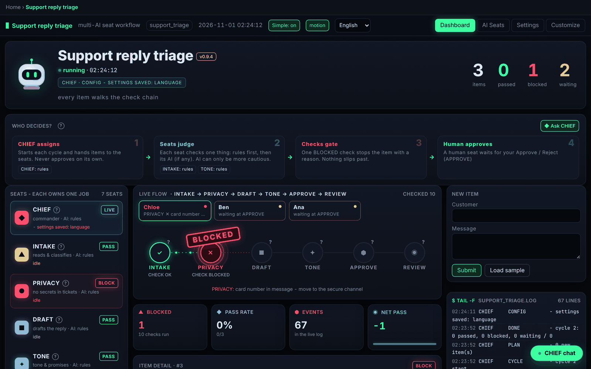
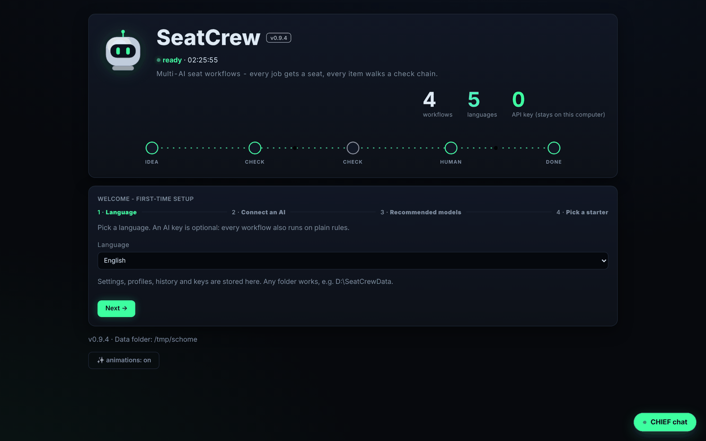
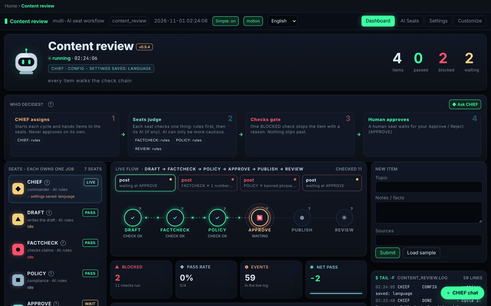
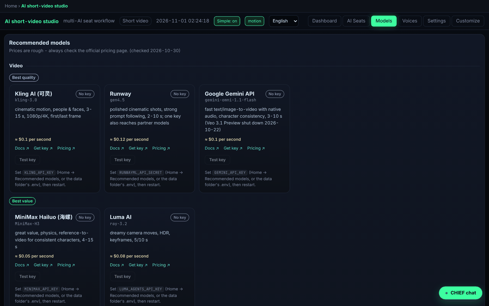
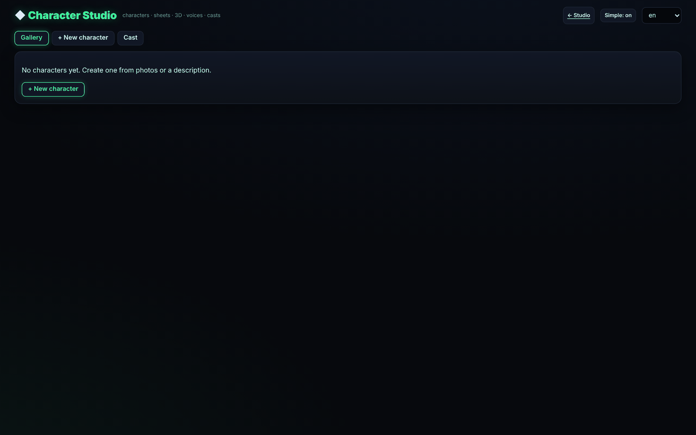

# SeatCrew 🪑🤖

[English](README.md) · [简体中文](README.zh-CN.md)

**A small framework for multi-AI "seat" workflows. Every job gets a seat, every item walks a check chain, and any LLM (or plain rules) can sit in any seat.**

> **Trading is the showcase, not the point.** The flagship example, [TradeCrew](examples/trading/README.md), is a complete multi-AI paper-trading terminal built on this engine. The same engine runs a content-review pipeline, a support-triage flow written in YAML only, and a short-video studio.



*Screenshots are from v0.9.4 with no API key. Animations follow `prefers-reduced-motion` and can be switched off (Settings → display → animations, or the **motion** button).*

## What's new

See [CHANGELOG.md](CHANGELOG.md). Video rendering requires **FFmpeg and ffprobe on PATH**; desktop installs include the free Edge TTS package.

> **Honest notes.** Paid providers (video, image, 3D, cloud TTS and paid LLMs) are tested with mocked HTTP only, **not with real keys yet**. The things tested for real are the no-key path (edge-tts plus DRAFT visuals) and local Ollama. **Clone a voice only with the speaker's explicit permission.**

## Get started in 3 minutes

1. **Install** (any option below) and open SeatCrew. A 3-step wizard appears.
2. **SeatCrew checks this PC** (OS, NVIDIA GPU/VRAM, RAM, disk, installed `codex` / `claude` / `ollama`, keys already in the environment) and offers **Use recommended setup** - one click, works immediately with zero keys.
   - **Log in with ChatGPT / Codex** or **Log in with Claude**: use your own subscription through the vendors' official CLIs (`codex login`, `claude auth login`). Seats and CHIEF then call `codex exec` / `claude -p`. SeatCrew only shows the sign-in link / one-time code; it never reads or stores your tokens. Not installed? The wizard shows the install command (`npm install -g @openai/codex`, `npm install -g @anthropic-ai/claude-code`).
   - Or paste a key for any of 7 providers, or use free local **Ollama**, or **Demo mode**.
3. **Pick a starter workflow** (support triage, content review, paper trading). It opens right away.

You never need your own model to start. Every seat works with plain rules, and AI is optional and seat-by-seat. **Simple mode** (on by default) hides advanced parameters. Every seat and check has a **?** tooltip, and each dashboard shows a **Who decides?** card: CHIEF assigns the work, the seats judge, the checks gate, and a human approves.




## Talk to CHIEF (built-in chat)

Click **◆ CHIEF chat** (bottom-right on Home and every dashboard) or open `/chat` for a full page. Ask in any of the 5 languages:

- *"Who decides what?"* shows which AI (or rules) sits in each seat and how an item flows.
- *"Create a workflow that reviews job applications"* gives you a YAML preview. Press **Confirm** to save it.
- *"Switch to the light theme"* gives you a settings diff. Press **Confirm** to apply it.
- *"Run a sample item"* or *"Why isn't my AI working?"* runs a sample or troubleshoots.

CHIEF uses whichever provider you connected (OpenAI, Anthropic, Gemini, xAI, DeepSeek, Ollama, or custom). **Nothing changes until you press Confirm.** Keys are never sent to the AI or stored in chat history (pasted keys are scrubbed). Chat can't touch broker, live trading, or providers: trading stays paper-only. History lives in a local `chat.json` and **Clear** wipes it. With no AI connected, CHIEF runs an offline FAQ mode and links to where to get a key.


## Install (pick one)

### A. Let your AI coding agent install it (easiest)
Open **Codex**, **Claude Code**, **Cursor** or any coding agent that can run commands on your computer, and paste:

```text
Install SeatCrew from https://github.com/same222111/seatcrew for me. Follow INSTALL_WITH_AI.md in that repo
exactly: run install.sh (macOS/Linux) or install.ps1 (Windows), check the result line, put a SeatCrew
launcher shortcut on my desktop, open it once to confirm the window appears, then tell me what you did.
Do not ask me for API keys - SeatCrew works without them.
```
The agent follows [INSTALL_WITH_AI.md](INSTALL_WITH_AI.md): per-OS steps plus one script that does everything (Python check, private virtualenv, install, desktop shortcut).

### B. Download the app
Go to **[Releases](https://github.com/same222111/seatcrew/releases)** and download:
| OS | File | Then |
|---|---|---|
| Windows | `SeatCrew-<v>-windows-setup.exe` (or the portable `.zip`) | run the installer, keep "Create a desktop shortcut" ticked |
| macOS | `SeatCrew-<v>-macos.dmg` | drag SeatCrew to Applications; first launch: right-click → Open (the app is not notarized) |
| Linux | `SeatCrew-<v>-x86_64.AppImage` | `chmod +x SeatCrew-*.AppImage` and double-click it |

Double-click **SeatCrew**: its own window opens, a first-run wizard asks for a language (an AI key is optional), then you pick a workflow. The app starts and stops its local server by itself; your settings live in your user data folder.

**Choose where it goes.** The Windows installer asks for the install folder (any folder you can write to, e.g. `D:\SeatCrew`). It installs per-user, never needs admin rights, and remembers your choice on upgrade. The **portable `.zip`** contains a `portable.txt` marker: unzip it anywhere (even a USB stick) and SeatCrew keeps all data in a `data` folder next to `SeatCrew.exe`. Delete the marker to use the normal folder instead.

**Data folder** (settings, profiles, history, `.env` keys). The default is `%APPDATA%\SeatCrew` on Windows, `~/Library/Application Support/SeatCrew` on macOS and `~/.local/share/seatcrew` on Linux. You can pick another folder in the first-run wizard. Later, use **Change data folder** on the home screen (tick *move my existing data there* to take everything along). The choice is stored in a small `location.json` in the default folder (portable: next to the exe). The environment variable `SEATCREW_DATA_DIR=/path` overrides everything. The home screen shows your home folder as `~`, so screenshots don't leak your user name.

### C. One command in a terminal
```bash
curl -fsSL https://raw.githubusercontent.com/same222111/seatcrew/main/install.sh | bash        # macOS / Linux
irm https://raw.githubusercontent.com/same222111/seatcrew/main/install.ps1 | iex                # Windows PowerShell
```
Or with pip / pipx (no shortcut): `pipx install "seatcrew[desktop] @ git+https://github.com/same222111/seatcrew"` then `seatcrew-desktop` (Linux also needs `pipx inject seatcrew qtpy PyQt6 PyQt6-WebEngine`). Developers: see [Quick start](#quick-start).


## The two ideas
1. **Each seat owns one job.** A workflow is a set of seats. CHIEF is the commander, and the others are whatever jobs your domain needs, such as DRAFT, FACTCHECK, POLICY or APPROVE. A **Runner** runs the workflow on a schedule, or when you press *Run now*. You assign each seat its own AI provider, model and prompt, or plain rules.
2. **An idea is not a trigger.** Every item walks an ordered **check chain**. Each seat answers `CHECK OK` or `CHECK BLOCKED` with a reason, and the **first block stops the item**. A single point of failure is intercepted instead of running all the way to an action. A **human seat** parks the item until someone approves or rejects it. A **REVIEW** seat replays the result at the end and can undo it.

**AI can only make a seat more cautious.** A seat's AI answers with one label from a fixed list, and only labels marked as blocking can stop an item. If the AI fails (no key, a timeout, bad JSON or a budget limit), it abstains and the rules decide. Every workflow runs with **no API key at all**.

## What you get
| | |
|---|---|
| **Engine** (`seatcrew/core.py`) | `Seat`, `HumanSeat`, `Chief`, `Workflow` (check chain, event log, item state, persistence), `Runner` (scheduled or manual) |
| **LLM layer** (`seatcrew/llm.py`) | OpenAI, Anthropic, Gemini, xAI Grok, DeepSeek, **any OpenAI-compatible endpoint** and **local Ollama**. Keys come from `.env` only. Includes per-seat assignment, a call/cost budget and *Test connection* |
| **Generic dashboard** (`seatcrew/web`) | Seat grid with live activity, a vertical check-chain timeline per item, Approve/Reject buttons, a live log, a submit form, per-seat AI settings and workflow settings. It is drawn entirely from the workflow definition |
| **i18n** | English, Simplified Chinese, Traditional Chinese, Japanese and Spanish in the UI and CLI. A workflow can ship its own `locales/` |
| **Two ways to define a workflow** | **YAML** with no code (rules such as `require`, `block_if_match`, `classify`, `template`, plus `ai:` labels and `human: true`) or **Python** (subclass `Seat` and `Workflow`) |
| **Desktop app** (`seatcrew/desktop.py`) | Own window (pywebview), free ports, auto start/stop of the backend, first-run wizard, workflow launcher; packaged as Windows installer, macOS .dmg, Linux AppImage ([packaging/](packaging/)) |
| **CLI** | `seatcrew app`, `seatcrew new`, `seatcrew run`, `seatcrew ui`, `seatcrew list` and `seatcrew test-ai` |

## Examples
| Example | Defined in | Chain |
|---|---|---|
| [**trading**](examples/trading/README.md) (flagship: TradeCrew) | Python, full app | CHIEF · QUANT · STOCKS → SCAN → JUDGE → RISK → SIZE → FILLS → REVIEW, plus portfolios, Strategy Lab, backtests and a wizard |
| [**content_review**](examples/content_review/workflow.py) | Python, ~100 lines | DRAFT → FACTCHECK → POLICY → APPROVE (human) → PUBLISH → REVIEW (un-publishes on failure) |
| [**short_video**](docs/VIDEO.md) | Python | DIRECTOR · WRITER → SCRIPT CHECK → PRODUCTION → EDIT + QC → YOU APPROVE |
| [**support_triage**](examples/support_triage/workflow.yaml) | **YAML only** | INTAKE → PRIVACY → DRAFT → TONE → APPROVE (human) → REVIEW |


## Quick start
```bash
git clone https://github.com/same222111/seatcrew.git && cd seatcrew
python -m venv .venv && . .venv/bin/activate
pip install -e .                       # installs both `seatcrew` and `tradecrew`
cp .env.example .env                   # optional: add any AI keys you have

seatcrew list                          # trading, content_review, support_triage
seatcrew ui content_review             # dashboard at http://127.0.0.1:8800
seatcrew run support_triage --yes      # headless: run one cycle and approve the human gates
seatcrew new expense_approval          # scaffold workflows/expense_approval/workflow.yaml
seatcrew ui workflows/expense_approval
tradecrew start                        # the full trading terminal (http://127.0.0.1:8787)
```
Each workflow keeps its settings in `config.<name>.yaml` and its state in `state/<name>/`. `--lang zh-CN` (or `ja`, `es`, `zh-TW`) translates CLI output and works before or after the subcommand, e.g. `seatcrew --lang zh-CN video init demo` or `seatcrew video init demo --lang zh-CN`.

## Free voices and voice cloning (consent required)
- **edge-tts** (free Microsoft neural voices) is the default - nothing to install.
- Optional local engines, one click from the wizard, installed into **your data folder** (`<data>/voice_engines`, so choosing `D:\SeatCrewData` keeps the models off C:):
  **CosyVoice** (Apache-2.0, built-in speakers + zero-shot cloning) and **GPT-SoVITS** (MIT, via its own `api_v2.py` server). An NVIDIA GPU with 6 GB+ is recommended; without one they run on CPU and are slow (the wizard warns you).
- **F5-TTS** and **Fish Speech** weights are **non-commercial** (CC-BY-NC / CC-BY-NC-SA). They are labelled as such and never installed by default.
- **Never clone a voice without the speaker's permission.** Only clone your own voice or a recording whose speaker explicitly agreed. SeatCrew requires a consent checkbox per cloned voice and stores the consent statement and date next to it. Do not use cloned voices to impersonate or deceive anyone.

## Make it yours with your own AI
This repo is a **template**. Hand it to Codex, Claude, ChatGPT or Cursor together with a prompt from [CUSTOMIZE.md](CUSTOMIZE.md). [AGENTS.md](AGENTS.md) gives your AI the architecture map, the extension points and the rules it must keep. [ARCHITECTURE.md](ARCHITECTURE.md) explains how the engine works.

## Screenshots
| Content review (human gate) | TradeCrew terminal |
|---|---|
|  |  |

| Video studio: models | Character Studio |
|---|---|
|  |  |

## Navigation and customization
- Every workflow page has a big **← Back to home** button at the top left and a breadcrumb (`Home › <workflow>`). **Esc** (when you're not typing) or **Alt+←** also go back.
- The **Customize** tab edits everything for that workflow: the AI and prompt of each seat, thresholds and workflow parameters (for trading: watchlist, strategies, risk and sizing, data sources), plus display (theme dark/light/high-contrast, font size, density) and language. Input is validated before it's applied.
- **Save as profile** stores a named profile in `<data folder>/workflows/<workflow>/profiles/<name>.yaml`. You can **Load**, **Delete** and **Reset to default**. Profiles never contain API keys or secrets. The paper-trading lock and setup state are never part of a profile.

## Share your config
1. In **Customize**, pick a profile (or your current settings) and click **Export / share**.
2. Either **Download file** (`<workflow>-<name>.seatcrew.json`) or **Copy share code** (a compact `SC1.…` text you can paste in a chat).
3. The receiver clicks **Import…**, chooses the file or pastes the file/code, and clicks **Preview**. Preview shows who made it, the SeatCrew version and every change it would make. They then confirm the import, optionally applying it right away.

The file holds `seatcrew_profile` (schema version), `workflow`, `app_version`, an optional `author`, and `data`. Keys and secrets are stripped on export *and* on import. A file for another workflow or a newer schema is refused with a clear message. A different app version only shows a warning, and unknown settings are ignored. Want to publish a good setup? Add it to [`configs/`](configs/).


## Adding a language
1. Copy `seatcrew/locales/en.json` to `seatcrew/locales/<code>.json` and translate the values. Keep `{placeholders}`.
2. Add `"<code>": "Native name"` to `LANGUAGES` in `seatcrew/config.py`.
3. Optionally do the same for an example's `locales/` folder (seat names and form fields).
4. Run `pytest -q`. The tests check that every locale has every key and placeholder. Missing keys fall back to English.

## Security
- The dashboard binds to `127.0.0.1` and has no authentication. Do not expose it to the internet.
- Keys are read only from the environment or `.env`. The API reports only *whether* a key is present, and provider errors are scrubbed of key material.
- The trading example is **paper only**. It is educational software, not financial advice.

MIT licensed. See [CONTRIBUTING.md](CONTRIBUTING.md).


## Video workflow
The `short_video` workflow turns a topic or script into a vertical or landscape short. The seats are DIRECTOR, WRITER, SCRIPT CHECK, PRODUCTION (voice and visuals), EDIT + QC, and your approval. Characters keep one voice (and optionally one reference image) across every video. Paid video runs show a cost/time estimate first. Videos without a real voice and real visuals are labeled as DRAFT previews and are only for checking timing; they are not a sample of finished output. Full guide: [docs/VIDEO.md](docs/VIDEO.md).

```bash
python -m seatcrew video models                 # recommended models + which keys are set
python -m seatcrew video models --test kling    # check a key (never printed)
python -m seatcrew video estimate my_video --backend kling
```

### Recommended models (checked 2026-10-30, prices: check current pricing)
Also in the setup wizard, the Video studio, and CHIEF chat. Adapters other than edge-tts are tested with mocked HTTP only; see [what was tested live](docs/VIDEO.md#what-was-tested-live-vs-mock-only).

| Tier | Kind | Provider | Model | Good at | Env var | Docs | Get key | Pricing |
|---|---|---|---|---|---|---|---|---|
| Best quality | Video | Kling AI | `kling-3.0` | cinematic motion, people & faces, 3-15 s, 1080p/4K, first/last frame | `KLING_API_KEY` | [Docs](https://kling.ai/document-api/guides/get-started/quick-start) | [Get key](https://kling.ai/dev/api-key) | [Pricing](https://kling.ai/dev/pricing) |
| Best quality | Video | Runway | `gen4.5` | polished cinematic shots, strong prompt following, 2-10 s; one key also reaches partner models | `RUNWAYML_API_SECRET` | [Docs](https://docs.dev.runwayml.com/guides/using-the-api/) | [Get key](https://dev.runwayml.com/) | [Pricing](https://docs.dev.runwayml.com/guides/pricing/) |
| Best quality | Video | Google Gemini API | `gemini-omni-1.1-flash` | fast text/image-to-video with native audio, character consistency, 3-10 s (Veo 3.1 Preview shut down 2026-10-22) | `GEMINI_API_KEY` | [Docs](https://ai.google.dev/gemini-api/docs/omni) | [Get key](https://aistudio.google.com/apikey) | [Pricing](https://ai.google.dev/gemini-api/docs/pricing) |
| Best value | Video | MiniMax Hailuo | `MiniMax-H3` | great value, physics, reference-to-video for consistent characters, 4-15 s | `MINIMAX_API_KEY` | [Docs](https://platform.minimax.io/docs/guides/video-generation) | [Get key](https://platform.minimax.io/console/keys) | [Pricing](https://platform.minimax.io/docs/pricing/overview) |
| Best value | Video | Luma AI | `ray-3.2` | dreamy camera moves, HDR, keyframes, 5/10 s | `LUMA_AGENTS_API_KEY` | [Docs](https://docs.agents.lumalabs.ai/guides/videos/generation/) | [Get key](https://platform.lumalabs.ai/) | [Pricing](https://docs.agents.lumalabs.ai/guides/pricing/) |
| Free / draft | Video | Offline draft cards | `-` | free, offline, labeled DRAFT - for checking timing only | no key | - | - | - |
| Best quality | Voice / TTS | ElevenLabs | `eleven_multilingual_v2 (default) / eleven_v3 / eleven_v4 via SEATCREW_ELEVEN_MODEL` | most expressive voices, instant voice cloning, exact word timestamps | `ELEVENLABS_API_KEY` | [Docs](https://elevenlabs.io/docs/overview/models) | [Get key](https://elevenlabs.io/app/developers/api-keys) | [Pricing](https://elevenlabs.io/pricing/api) |
| Best quality | Voice / TTS | MiniMax Speech | `speech-2.8-hd` | very natural Chinese, emotion parameter, voice clone from 10 s+ | `MINIMAX_API_KEY` | [Docs](https://platform.minimax.io/docs/api-reference/speech-t2a-http) | [Get key](https://platform.minimax.io/console/keys) | [Pricing](https://platform.minimax.io/docs/pricing/overview) |
| Best value | Voice / TTS | ByteDance Doubao / Volcano Engine | `seed-tts-2.0` | natural zh-CN voices with emotions, voice clone (seed-icl-2.0) | `VOLC_TTS_API_KEY` | [Docs](https://docs.volcengine.com/docs/doubao-voice/http-chunked-sse-unidirectional-streaming-v3?lang=zh) | [Get key](https://console.volcengine.com/speech/app) | [Pricing](https://docs.volcengine.com/docs/doubao-voice/billing-instructions?lang=zh) |
| Best value | Voice / TTS | Azure AI Speech | `Neural / HD voices (zh-CN-XiaoxiaoNeural ...)` | real SSML speaking styles (sad, gentle, cheerful ...) for zh-CN/en/ja voices | `AZURE_SPEECH_KEY`, `AZURE_SPEECH_REGION` | [Docs](https://learn.microsoft.com/en-us/azure/ai-services/speech-service/speech-synthesis-markup-voice) | [Get key](https://portal.azure.com/#create/Microsoft.CognitiveServicesSpeechServices) | [Pricing](https://azure.microsoft.com/en-us/pricing/details/speech/) |
| Best value | Voice / TTS | OpenAI TTS | `gpt-4o-mini-tts` | tone via instructions; whisper word timing (deprecated, shuts down 2027-01-06) | `OPENAI_API_KEY` | [Docs](https://developers.openai.com/api/docs/guides/text-to-speech) | [Get key](https://platform.openai.com/api-keys) | [Pricing](https://developers.openai.com/api/docs/pricing) |
| Free / draft | Voice / TTS | Microsoft Edge neural voices (edge-tts) | `zh-CN-XiaoxiaoNeural etc.` | free, no key, good neural voices; styles only approximated | no key | [Docs](https://github.com/rany2/edge-tts) | - | - |

### Character Studio
Open `/characters` from the Video studio. You can make characters from photos or a description and generate a consistent sheet (front, side, full body, expressions) with OpenAI, Gemini, MiniMax or Replicate FLUX. An optional image-to-3D step (Meshy, Tripo or Replicate) feeds a bundled 360° viewer. You can lock a character's refs, bind or clone a voice, and build a cast of up to 5 with roles. **Shoot with this cast** runs a dialogue scene: lines only for cast members, wide → OTS → close-up coverage, hard cuts, no music, room tone, optional lip-sync, and continuity QC. Without keys you get labeled DRAFT sheets and a flat "standee" model. All cloud adapters are mock-tested only. Guide and limits: [docs/VIDEO.md](docs/VIDEO.md#character-studio-characters).

Chinese/Japanese video text uses installed CJK fonts (macOS Heiti, Windows Microsoft YaHei, or Linux Noto Sans CJK). You can also place NotoSansSC TTF/OTF fonts in `SEATCREW_FONTS_DIR`. Missing fonts produce a clear error instead of unreadable boxes.
