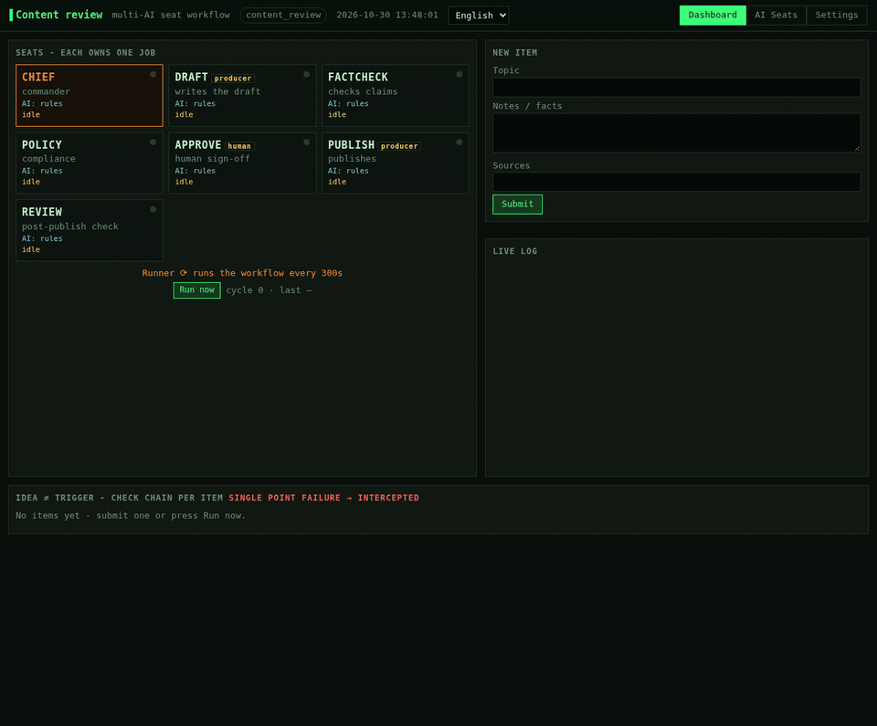
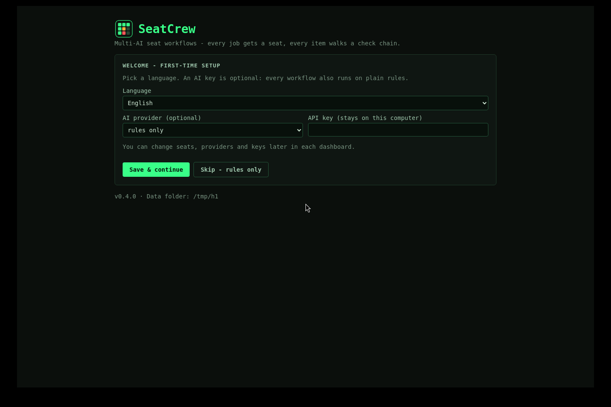
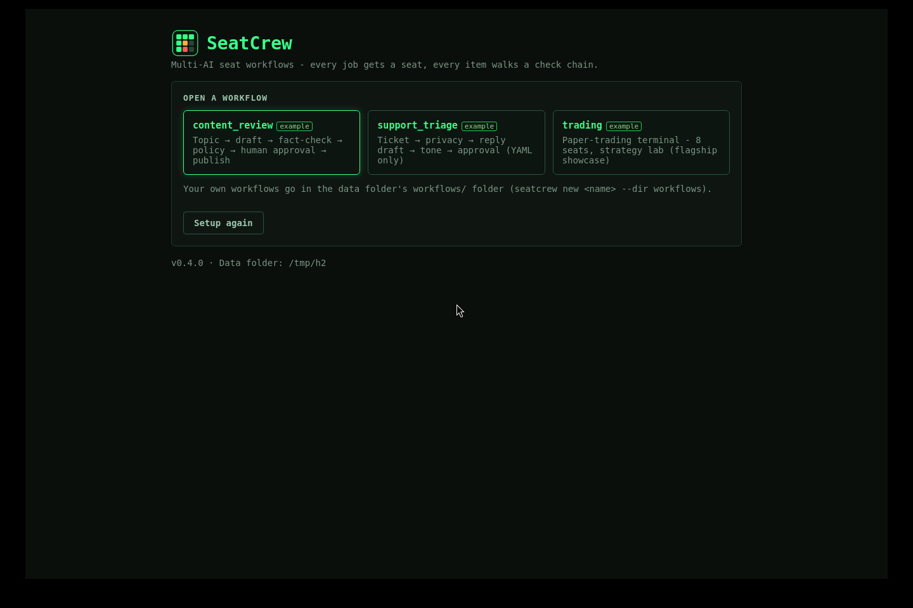
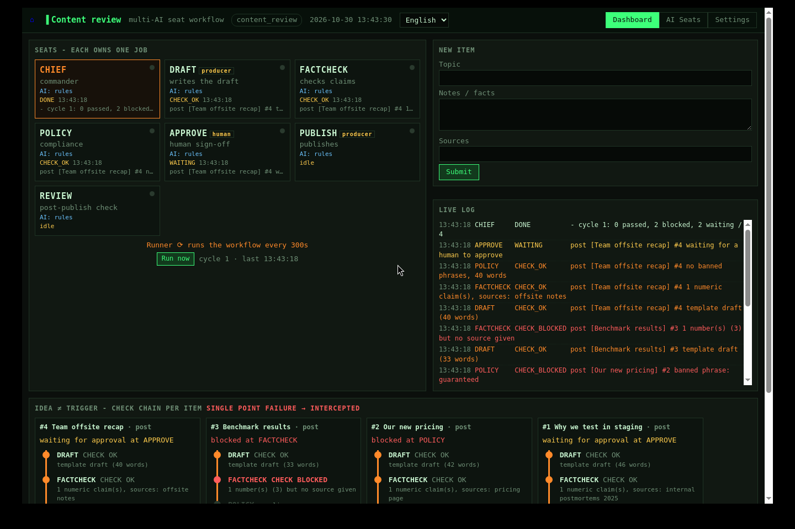
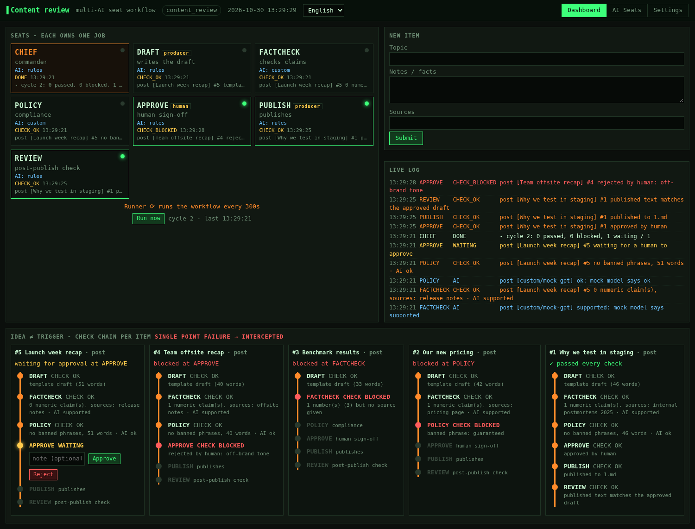
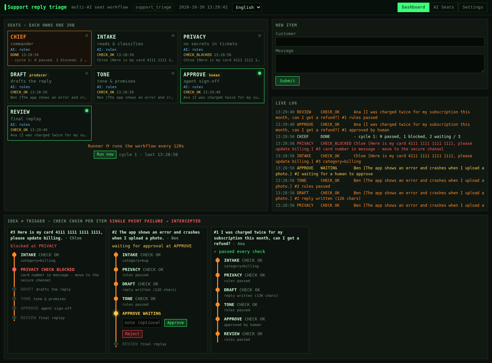
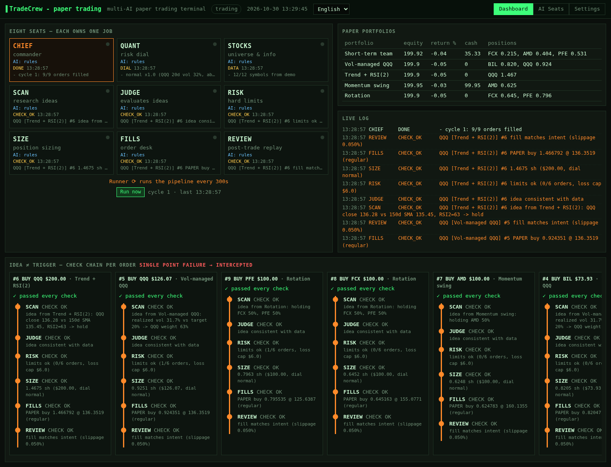
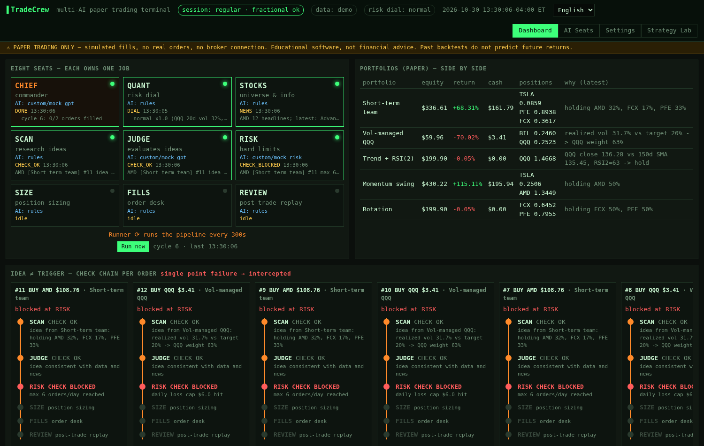

# SeatCrew 🪑🤖

**A small framework for multi-AI "seat" workflows. Every job gets a seat, every item walks a check chain, and any LLM (or plain rules) can sit in any seat.**

> **Trading is the showcase, not the point.** The flagship example, [TradeCrew](examples/trading/README.md), is a complete multi-AI paper-trading terminal built on this engine. The same engine runs a content-review pipeline and a support-triage flow written in YAML only.



## Install (pick one)

### A. Let your AI coding agent install it (easiest)
Open **Codex**, **Claude Code**, **Cursor** or any coding agent that can run commands on your computer, and paste:

```text
Install SeatCrew from https://github.com/same222111/seatcrew for me. Follow INSTALL_WITH_AI.md in that repo
exactly: run install.sh (macOS/Linux) or install.ps1 (Windows), check the result line, put a SeatCrew
launcher shortcut on my desktop, open it once to confirm the window appears, then tell me what you did.
Do not ask me for API keys - SeatCrew works without them.
```
The agent follows [INSTALL_WITH_AI.md](INSTALL_WITH_AI.md): per-OS steps plus one script that does everything (Python check, private virtualenv, install, desktop shortcut).

### B. Download the app
Go to **[Releases](https://github.com/same222111/seatcrew/releases)** and download:
| OS | File | Then |
|---|---|---|
| Windows | `SeatCrew-<v>-windows-setup.exe` (or the portable `.zip`) | run the installer, keep "Create a desktop shortcut" ticked |
| macOS | `SeatCrew-<v>-macos.dmg` | drag SeatCrew to Applications; first launch: right-click → Open (the app is not notarized) |
| Linux | `SeatCrew-<v>-x86_64.AppImage` | `chmod +x SeatCrew-*.AppImage` and double-click it |

Double-click **SeatCrew**: its own window opens, a first-run wizard asks for a language (an AI key is optional), then you pick a workflow. The app starts and stops its local server by itself; your settings live in your user data folder.

### C. One command in a terminal
```bash
curl -fsSL https://raw.githubusercontent.com/same222111/seatcrew/main/install.sh | bash        # macOS / Linux
irm https://raw.githubusercontent.com/same222111/seatcrew/main/install.ps1 | iex                # Windows PowerShell
```
Or with pip / pipx (no shortcut): `pipx install "seatcrew[desktop] @ git+https://github.com/same222111/seatcrew"` then `seatcrew-desktop` (Linux also needs `pipx inject seatcrew qtpy PyQt6 PyQt6-WebEngine`). Developers: see [Quick start](#quick-start).

| First-run wizard | Pick a workflow | Desktop window |
|---|---|---|
|  |  |  |

## The two ideas
1. **Each seat owns one job (八席，各管一摊).** A workflow is a set of seats. CHIEF is the commander, and the others are whatever jobs your domain needs, such as DRAFT, FACTCHECK, POLICY or APPROVE. A **Runner** runs the workflow on a schedule, or when you press *Run now*. You assign each seat its own AI provider, model and prompt, or plain rules.
2. **An idea is not a trigger (想法 ≠ 扳机).** Every item walks an ordered **check chain**. Each seat answers `CHECK OK` or `CHECK BLOCKED` with a reason, and the **first block stops the item**. A single point of failure is intercepted instead of running all the way to an action. A **human seat** parks the item until someone approves or rejects it. A **REVIEW** seat replays the result at the end and can undo it.

**AI can only make a seat more cautious.** A seat's AI answers with one label from a fixed list, and only labels marked as blocking can stop an item. If the AI fails (no key, a timeout, bad JSON or a budget limit), it abstains and the rules decide. Every workflow runs with **no API key at all**.

## What you get
| | |
|---|---|
| **Engine** (`seatcrew/core.py`) | `Seat`, `HumanSeat`, `Chief`, `Workflow` (check chain, event log, item state, persistence), `Runner` (scheduled or manual) |
| **LLM layer** (`seatcrew/llm.py`) | OpenAI, Anthropic, Gemini, xAI Grok, DeepSeek, **any OpenAI-compatible endpoint** and **local Ollama**. Keys come from `.env` only. Includes per-seat assignment, a call/cost budget and *Test connection* |
| **Generic dashboard** (`seatcrew/web`) | Seat grid with live activity, a vertical check-chain timeline per item, Approve/Reject buttons, a live log, a submit form, per-seat AI settings and workflow settings. It is drawn entirely from the workflow definition |
| **i18n** | English, 简体中文, 繁體中文, 日本語 and Español in the UI and CLI. A workflow can ship its own `locales/` |
| **Two ways to define a workflow** | **YAML** with no code (rules such as `require`, `block_if_match`, `classify`, `template`, plus `ai:` labels and `human: true`) or **Python** (subclass `Seat` and `Workflow`) |
| **Desktop app** (`seatcrew/desktop.py`) | Own window (pywebview), free ports, auto start/stop of the backend, first-run wizard, workflow launcher; packaged as Windows installer, macOS .dmg, Linux AppImage ([packaging/](packaging/)) |
| **CLI** | `seatcrew app`, `seatcrew new`, `seatcrew run`, `seatcrew ui`, `seatcrew list` and `seatcrew test-ai` |

## Examples
| Example | Defined in | Chain |
|---|---|---|
| [**trading**](examples/trading/README.md) (flagship: TradeCrew) | Python, full app | CHIEF · QUANT · STOCKS → SCAN → JUDGE → RISK → SIZE → FILLS → REVIEW, plus portfolios, Strategy Lab, backtests and a wizard |
| [**content_review**](examples/content_review/workflow.py) | Python, ~100 lines | DRAFT → FACTCHECK → POLICY → APPROVE (human) → PUBLISH → REVIEW (un-publishes on failure) |
| [**support_triage**](examples/support_triage/workflow.yaml) | **YAML only** | INTAKE → PRIVACY → DRAFT → TONE → APPROVE (human) → REVIEW |

## Quick start
```bash
git clone https://github.com/same222111/seatcrew.git && cd seatcrew
python -m venv .venv && . .venv/bin/activate
pip install -e .                       # installs both `seatcrew` and `tradecrew`
cp .env.example .env                   # optional: add any AI keys you have

seatcrew list                          # trading, content_review, support_triage
seatcrew ui content_review             # dashboard at http://127.0.0.1:8800
seatcrew run support_triage --yes      # headless: run one cycle and approve the human gates
seatcrew new expense_approval          # scaffold workflows/expense_approval/workflow.yaml
seatcrew ui workflows/expense_approval
tradecrew start                        # the full trading terminal (http://127.0.0.1:8787)
```
Each workflow keeps its settings in `config.<name>.yaml` and its state in `state/<name>/`. Use `--lang zh-CN` (or ja, es, zh-TW) for translated CLI output.

## Make it yours with your own AI
This repo is a **template**. Hand it to Codex, Claude, ChatGPT or Cursor together with a prompt from [CUSTOMIZE.md](CUSTOMIZE.md). [AGENTS.md](AGENTS.md) gives your AI the architecture map, the extension points and the rules it must keep. [ARCHITECTURE.md](ARCHITECTURE.md) explains how the engine works.

## Screenshots
| Content review (human gate) | Support triage (YAML) | Trading on the generic dashboard | TradeCrew terminal |
|---|---|---|---|
|  |  |  |  |

## Adding a language
1. Copy `seatcrew/locales/en.json` to `seatcrew/locales/<code>.json` and translate the values. Keep `{placeholders}`.
2. Add `"<code>": "Native name"` to `LANGUAGES` in `seatcrew/config.py`.
3. Optionally do the same for an example's `locales/` folder (seat names and form fields).
4. Run `pytest -q`. The tests check that every locale has every key and placeholder. Missing keys fall back to English.

## Security
- The dashboard binds to `127.0.0.1` and has no authentication. Do not expose it to the internet.
- Keys are read only from the environment or `.env`. The API reports only *whether* a key is present, and provider errors are scrubbed of key material.
- The trading example is **paper only**. It is educational software, not financial advice.

MIT licensed. See [CONTRIBUTING.md](CONTRIBUTING.md).

---

## 中文说明
**安装(三选一)**:① 把上面那段英文提示词复制给 Codex / Claude Code / Cursor,让它按 [INSTALL_WITH_AI.md](INSTALL_WITH_AI.md) 自动安装并在桌面放一个 SeatCrew 快捷方式;② 到 Releases 下载安装包(Windows `.exe`、macOS `.dmg`、Linux `.AppImage`),双击即可打开独立窗口,首次启动有向导;③ 终端一行命令 `install.sh` / `install.ps1`,或 `pipx install`。

给 AI 的中文提示词(直接复制):
```text
请从 https://github.com/same222111/seatcrew 帮我安装 SeatCrew。严格按照仓库里的 INSTALL_WITH_AI.md 操作:
macOS/Linux 运行 install.sh,Windows 运行 install.ps1,检查最后的 RESULT 行,在我的桌面放一个 SeatCrew 快捷方式,
打开一次确认窗口出现,然后告诉我你做了什么。不要向我要 API 密钥,没有密钥也能用。
```

**SeatCrew：多 AI「席位」工作流框架。** 核心是一套可复用的 agent 工作流结构，交易只是其中的成品展示。

- **八席，各管一摊**：一个工作流由若干席位组成。CHIEF 是总指挥，其余席位按你的业务来定（例如 起草、核查、合规、人工审批）。Runner 按计划运行，也可以点“立即运行”。每个席位都可以单独指定 AI（OpenAI / Anthropic / Gemini / Grok / DeepSeek / 任意 OpenAI 兼容接口 / 本地 Ollama），也可以只用规则。
- **想法 ≠ 扳机**：每个事项都要按顺序走完检查链。每个席位给出 CHECK OK 或 CHECK BLOCKED 和原因，**单点出错就会被拦截**。人工席位会让事项停下，等人批准或驳回。最后由 REVIEW 复盘，必要时撤销结果。
- **AI 只能让决策更谨慎**：AI 可以增加拦截，不能取消拦截。AI 出错时弃权，由规则决定。没有任何 Key 也能完整运行。
- **两种定义方式**：只写 YAML（零代码，见 `examples/support_triage`），或者写 Python（见 `examples/content_review`）。
- **自带示例**：`trading`（旗舰成品 TradeCrew，多 AI 模拟交易终端，功能完整保留）、`content_review`（内容审核）、`support_triage`（客服回复分流）。
- **多语言**：English、简体中文、繁體中文、日本語、Español，界面和命令行都支持。
- **当作模板使用**：把整个仓库交给你自己的 AI（Codex / Claude / ChatGPT / Cursor），贴上 [CUSTOMIZE.md](CUSTOMIZE.md) 里的提示词，就能做出你自己的工作流。

快速开始：`pip install -e .`，然后运行 `seatcrew ui content_review`，打开 http://127.0.0.1:8800 。新建工作流用 `seatcrew new my_flow`（名称只能用小写英文、数字和下划线），交易终端用 `tradecrew start`。
