# SeatCrew 🪑🤖

**A small framework for multi-AI "seat" workflows. Every job gets a seat, every item walks a check chain, and any LLM (or plain rules) can sit in any seat.**

> **Trading is the showcase, not the point.** The flagship example, [TradeCrew](examples/trading/README.md), is a complete multi-AI paper-trading terminal built on this engine. The same engine runs a content-review pipeline and a support-triage flow written in YAML only.


*v0.6 "Night Shift" UI: seat cards with status badges, an animated check chain, live log. Animations follow `prefers-reduced-motion` and can be switched off (Settings → display → animations, or the **motion** button). [Watch the MP4](docs/demo.mp4).*

## Get started in 3 minutes

1. **Install** (any option below) and open SeatCrew. A 3-step wizard appears.
2. **Pick your language, then connect one AI**: paste a key for any of 7 providers and press **Test connection**, or choose free local **Ollama**, or pick **Demo mode** (no AI, nothing to set up).
3. **Pick a starter workflow** (support triage, content review, paper trading). It opens right away.

You never need your own model to start. Every seat works with plain rules, and AI is optional and seat-by-seat. **Simple mode** (on by default) hides advanced parameters. Every seat and check has a **?** tooltip, and each dashboard shows a **Who decides?** card: CHIEF assigns the work, the seats judge, the checks gate, and a human approves.

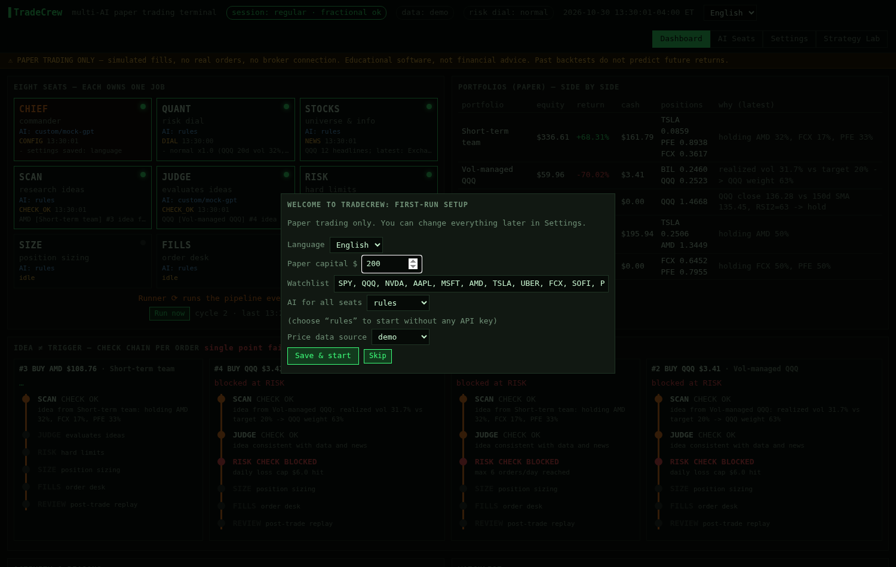

## Talk to CHIEF (built-in chat)

Click **◆ CHIEF chat** (bottom-right on Home and every dashboard) or open `/chat` for a full page. Ask in any of the 5 languages:

- *"Who decides what?"* shows which AI (or rules) sits in each seat and how an item flows.
- *"Create a workflow that reviews job applications"* gives you a YAML preview. Press **Confirm** to save it.
- *"Switch to the light theme"* gives you a settings diff. Press **Confirm** to apply it.
- *"Run a sample item"* or *"Why isn't my AI working?"* runs a sample or troubleshoots.

CHIEF uses whichever provider you connected (OpenAI, Anthropic, Gemini, xAI, DeepSeek, Ollama, or custom). **Nothing changes until you press Confirm.** Keys are never sent to the AI or stored in chat history (pasted keys are scrubbed). Chat can't touch broker, live trading, or providers: trading stays paper-only. History lives in a local `chat.json` and **Clear** wipes it. With no AI connected, CHIEF runs an offline FAQ mode and links to where to get a key.

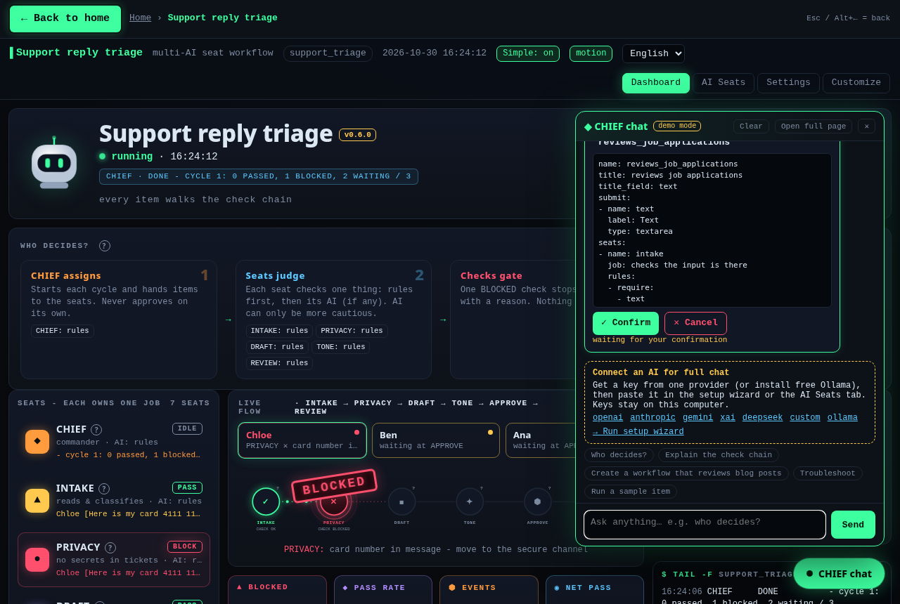
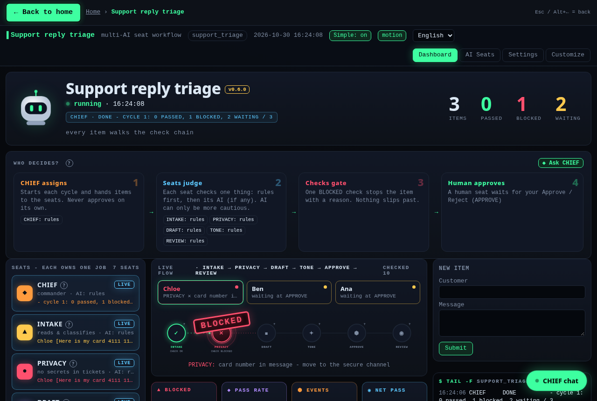

## Install (pick one)

### A. Let your AI coding agent install it (easiest)
Open **Codex**, **Claude Code**, **Cursor** or any coding agent that can run commands on your computer, and paste:

```text
Install SeatCrew from https://github.com/same222111/seatcrew for me. Follow INSTALL_WITH_AI.md in that repo
exactly: run install.sh (macOS/Linux) or install.ps1 (Windows), check the result line, put a SeatCrew
launcher shortcut on my desktop, open it once to confirm the window appears, then tell me what you did.
Do not ask me for API keys - SeatCrew works without them.
```
The agent follows [INSTALL_WITH_AI.md](INSTALL_WITH_AI.md): per-OS steps plus one script that does everything (Python check, private virtualenv, install, desktop shortcut).

### B. Download the app
Go to **[Releases](https://github.com/same222111/seatcrew/releases)** and download:
| OS | File | Then |
|---|---|---|
| Windows | `SeatCrew-<v>-windows-setup.exe` (or the portable `.zip`) | run the installer, keep "Create a desktop shortcut" ticked |
| macOS | `SeatCrew-<v>-macos.dmg` | drag SeatCrew to Applications; first launch: right-click → Open (the app is not notarized) |
| Linux | `SeatCrew-<v>-x86_64.AppImage` | `chmod +x SeatCrew-*.AppImage` and double-click it |

Double-click **SeatCrew**: its own window opens, a first-run wizard asks for a language (an AI key is optional), then you pick a workflow. The app starts and stops its local server by itself; your settings live in your user data folder.

**Choose where it goes.** The Windows installer asks for the install folder (any folder you can write to, e.g. `D:\SeatCrew`). It installs per-user, never needs admin rights, and remembers your choice on upgrade. The **portable `.zip`** contains a `portable.txt` marker: unzip it anywhere (even a USB stick) and SeatCrew keeps all data in a `data` folder next to `SeatCrew.exe`. Delete the marker to use the normal folder instead.

**Data folder** (settings, profiles, history, `.env` keys). The default is `%APPDATA%\SeatCrew` on Windows, `~/Library/Application Support/SeatCrew` on macOS and `~/.local/share/seatcrew` on Linux. You can pick another folder in the first-run wizard. Later, use **Change data folder** on the home screen (tick *move my existing data there* to take everything along). The choice is stored in a small `location.json` in the default folder (portable: next to the exe). The environment variable `SEATCREW_DATA_DIR=/path` overrides everything. The home screen shows your home folder as `~`, so screenshots don't leak your user name.

### C. One command in a terminal
```bash
curl -fsSL https://raw.githubusercontent.com/same222111/seatcrew/main/install.sh | bash        # macOS / Linux
irm https://raw.githubusercontent.com/same222111/seatcrew/main/install.ps1 | iex                # Windows PowerShell
```
Or with pip / pipx (no shortcut): `pipx install "seatcrew[desktop] @ git+https://github.com/same222111/seatcrew"` then `seatcrew-desktop` (Linux also needs `pipx inject seatcrew qtpy PyQt6 PyQt6-WebEngine`). Developers: see [Quick start](#quick-start).

| First-run wizard | Pick a workflow | Desktop window |
|---|---|---|
|  |  |  |

## The two ideas
1. **Each seat owns one job (八席，各管一摊).** A workflow is a set of seats. CHIEF is the commander, and the others are whatever jobs your domain needs, such as DRAFT, FACTCHECK, POLICY or APPROVE. A **Runner** runs the workflow on a schedule, or when you press *Run now*. You assign each seat its own AI provider, model and prompt, or plain rules.
2. **An idea is not a trigger (想法 ≠ 扳机).** Every item walks an ordered **check chain**. Each seat answers `CHECK OK` or `CHECK BLOCKED` with a reason, and the **first block stops the item**. A single point of failure is intercepted instead of running all the way to an action. A **human seat** parks the item until someone approves or rejects it. A **REVIEW** seat replays the result at the end and can undo it.

**AI can only make a seat more cautious.** A seat's AI answers with one label from a fixed list, and only labels marked as blocking can stop an item. If the AI fails (no key, a timeout, bad JSON or a budget limit), it abstains and the rules decide. Every workflow runs with **no API key at all**.

## What you get
| | |
|---|---|
| **Engine** (`seatcrew/core.py`) | `Seat`, `HumanSeat`, `Chief`, `Workflow` (check chain, event log, item state, persistence), `Runner` (scheduled or manual) |
| **LLM layer** (`seatcrew/llm.py`) | OpenAI, Anthropic, Gemini, xAI Grok, DeepSeek, **any OpenAI-compatible endpoint** and **local Ollama**. Keys come from `.env` only. Includes per-seat assignment, a call/cost budget and *Test connection* |
| **Generic dashboard** (`seatcrew/web`) | Seat grid with live activity, a vertical check-chain timeline per item, Approve/Reject buttons, a live log, a submit form, per-seat AI settings and workflow settings. It is drawn entirely from the workflow definition |
| **i18n** | English, 简体中文, 繁體中文, 日本語 and Español in the UI and CLI. A workflow can ship its own `locales/` |
| **Two ways to define a workflow** | **YAML** with no code (rules such as `require`, `block_if_match`, `classify`, `template`, plus `ai:` labels and `human: true`) or **Python** (subclass `Seat` and `Workflow`) |
| **Desktop app** (`seatcrew/desktop.py`) | Own window (pywebview), free ports, auto start/stop of the backend, first-run wizard, workflow launcher; packaged as Windows installer, macOS .dmg, Linux AppImage ([packaging/](packaging/)) |
| **CLI** | `seatcrew app`, `seatcrew new`, `seatcrew run`, `seatcrew ui`, `seatcrew list` and `seatcrew test-ai` |

## Examples
| Example | Defined in | Chain |
|---|---|---|
| [**trading**](examples/trading/README.md) (flagship: TradeCrew) | Python, full app | CHIEF · QUANT · STOCKS → SCAN → JUDGE → RISK → SIZE → FILLS → REVIEW, plus portfolios, Strategy Lab, backtests and a wizard |
| [**content_review**](examples/content_review/workflow.py) | Python, ~100 lines | DRAFT → FACTCHECK → POLICY → APPROVE (human) → PUBLISH → REVIEW (un-publishes on failure) |
| [**support_triage**](examples/support_triage/workflow.yaml) | **YAML only** | INTAKE → PRIVACY → DRAFT → TONE → APPROVE (human) → REVIEW |

## Quick start
```bash
git clone https://github.com/same222111/seatcrew.git && cd seatcrew
python -m venv .venv && . .venv/bin/activate
pip install -e .                       # installs both `seatcrew` and `tradecrew`
cp .env.example .env                   # optional: add any AI keys you have

seatcrew list                          # trading, content_review, support_triage
seatcrew ui content_review             # dashboard at http://127.0.0.1:8800
seatcrew run support_triage --yes      # headless: run one cycle and approve the human gates
seatcrew new expense_approval          # scaffold workflows/expense_approval/workflow.yaml
seatcrew ui workflows/expense_approval
tradecrew start                        # the full trading terminal (http://127.0.0.1:8787)
```
Each workflow keeps its settings in `config.<name>.yaml` and its state in `state/<name>/`. Use `--lang zh-CN` (or ja, es, zh-TW) for translated CLI output.

## Make it yours with your own AI
This repo is a **template**. Hand it to Codex, Claude, ChatGPT or Cursor together with a prompt from [CUSTOMIZE.md](CUSTOMIZE.md). [AGENTS.md](AGENTS.md) gives your AI the architecture map, the extension points and the rules it must keep. [ARCHITECTURE.md](ARCHITECTURE.md) explains how the engine works.

## Screenshots
| Home | Live flow | Blocked check |
|---|---|---|
| 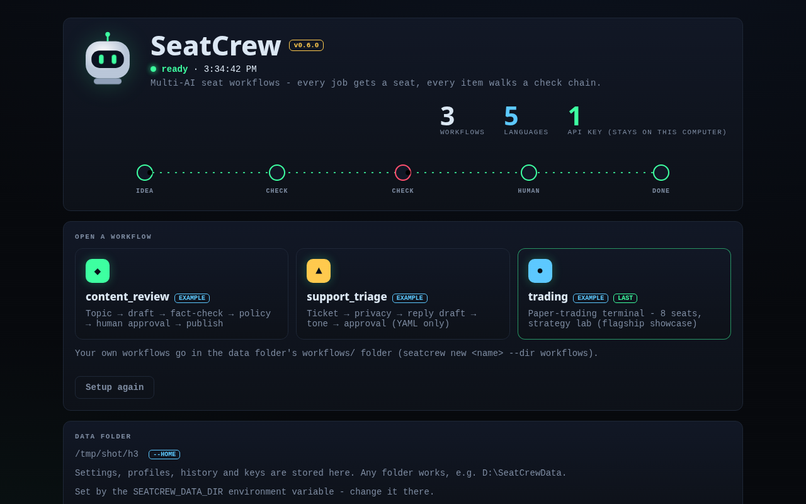 | 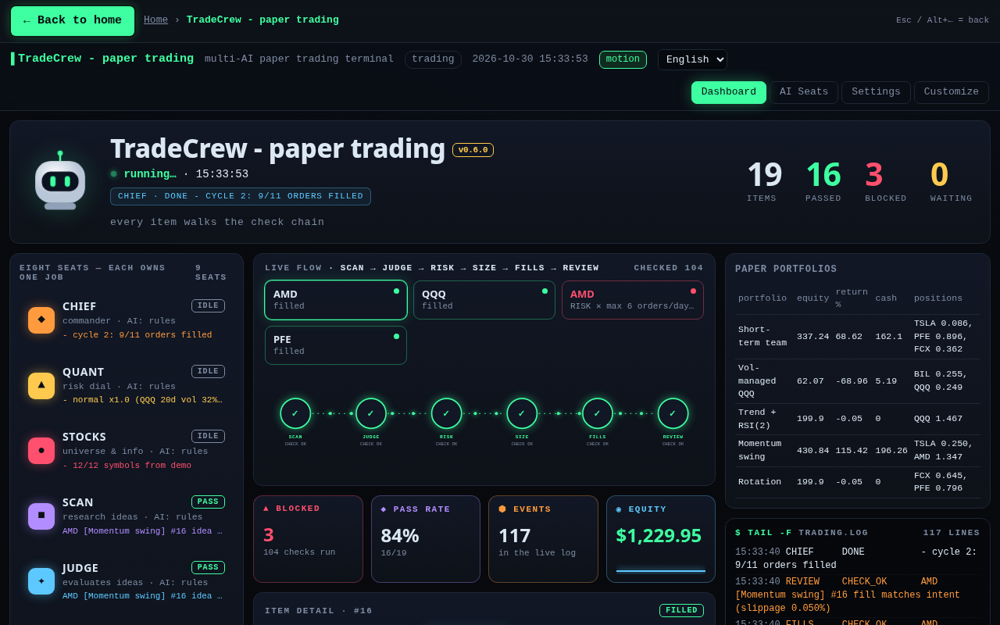 | 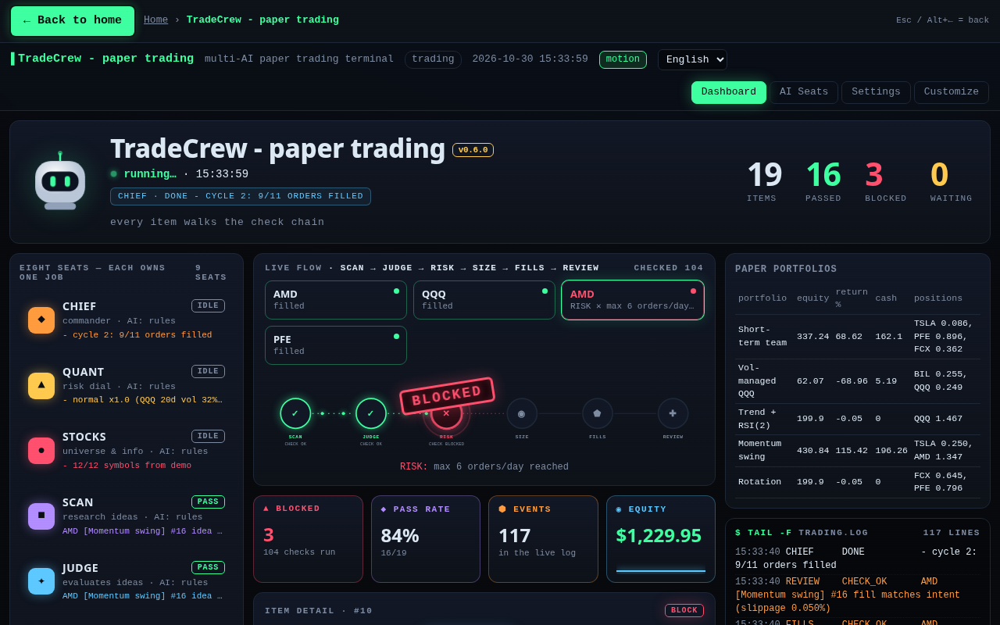 |

| Light theme | TradeCrew terminal | Share code |
|---|---|---|
| 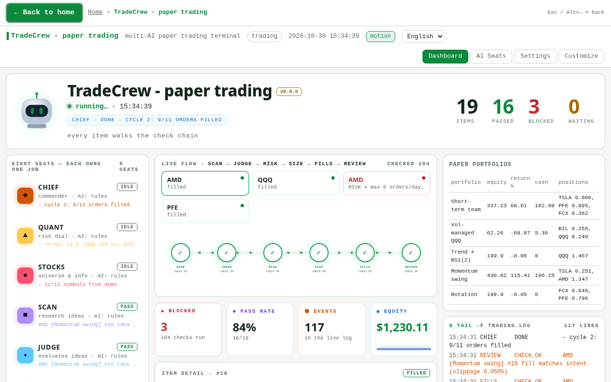 | 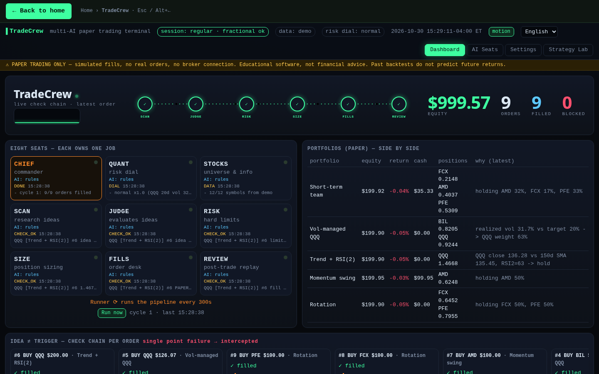 | 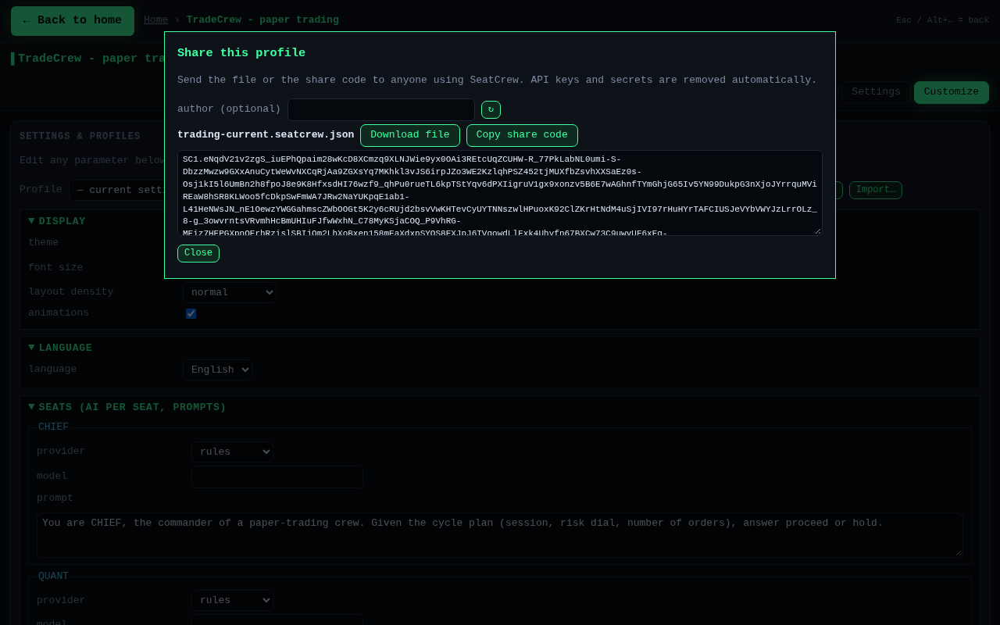 |

| Content review (human gate) | Support triage (YAML) | Trading on the generic dashboard | TradeCrew terminal |
|---|---|---|---|
|  |  |  |  |

## Navigation and customization
- Every workflow page has a big **← Back to home** button at the top left and a breadcrumb (`Home › <workflow>`). **Esc** (when you're not typing) or **Alt+←** also go back.
- The **Customize** tab edits everything for that workflow: the AI and prompt of each seat, thresholds and workflow parameters (for trading: watchlist, strategies, risk and sizing, data sources), plus display (theme dark/light/high-contrast, font size, density) and language. Input is validated before it's applied.
- **Save as profile** stores a named profile in `<data folder>/workflows/<workflow>/profiles/<name>.yaml`. You can **Load**, **Delete** and **Reset to default**. Profiles never contain API keys or secrets. The paper-trading lock and setup state are never part of a profile.

## Share your config
1. In **Customize**, pick a profile (or your current settings) and click **Export / share**.
2. Either **Download file** (`<workflow>-<name>.seatcrew.json`) or **Copy share code** (a compact `SC1.…` text you can paste in a chat).
3. The receiver clicks **Import…**, chooses the file or pastes the file/code, and clicks **Preview**. Preview shows who made it, the SeatCrew version and every change it would make. They then confirm the import, optionally applying it right away.

The file holds `seatcrew_profile` (schema version), `workflow`, `app_version`, an optional `author`, and `data`. Keys and secrets are stripped on export *and* on import. A file for another workflow or a newer schema is refused with a clear message. A different app version only shows a warning, and unknown settings are ignored. Want to publish a good setup? Add it to [`configs/`](configs/).

| Big back button | Parameter editor | Import preview |
|---|---|---|
| 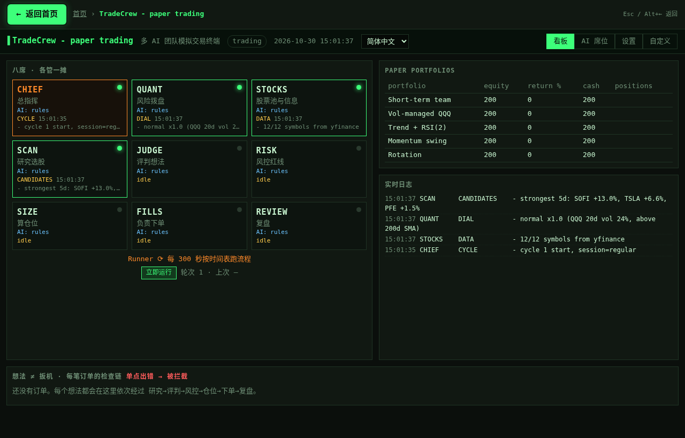 | 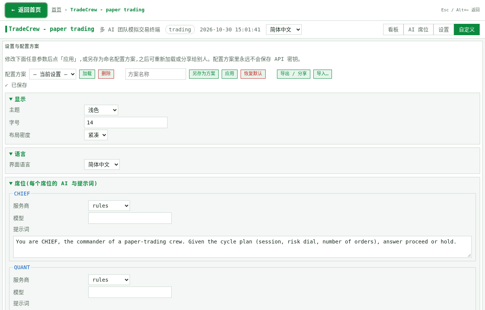 | 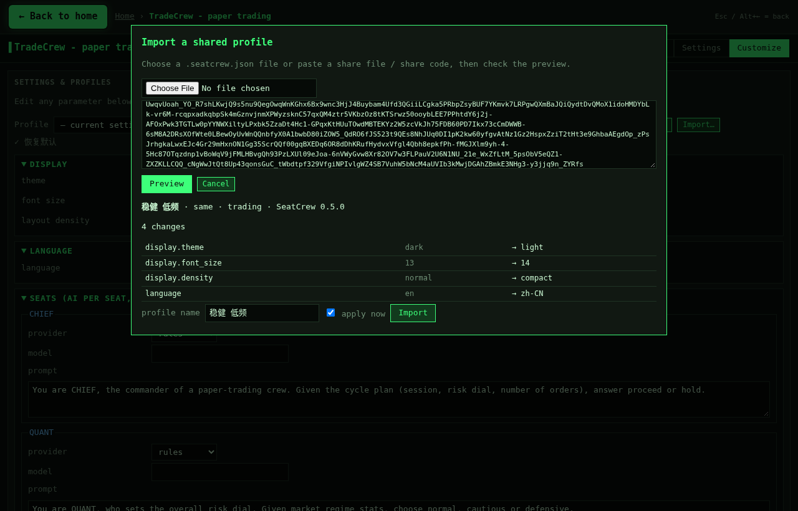 |

## Adding a language
1. Copy `seatcrew/locales/en.json` to `seatcrew/locales/<code>.json` and translate the values. Keep `{placeholders}`.
2. Add `"<code>": "Native name"` to `LANGUAGES` in `seatcrew/config.py`.
3. Optionally do the same for an example's `locales/` folder (seat names and form fields).
4. Run `pytest -q`. The tests check that every locale has every key and placeholder. Missing keys fall back to English.

## Security
- The dashboard binds to `127.0.0.1` and has no authentication. Do not expose it to the internet.
- Keys are read only from the environment or `.env`. The API reports only *whether* a key is present, and provider errors are scrubbed of key material.
- The trading example is **paper only**. It is educational software, not financial advice.

MIT licensed. See [CONTRIBUTING.md](CONTRIBUTING.md).

---

## 中文说明

### 3 分钟上手
1. 安装并打开 SeatCrew，首次启动出现 3 步向导。
2. 选语言，再接入一个 AI：在 7 家服务商里任选一家粘贴密钥，点「测试连接」；或选择免费本地 **Ollama**；或选 **演示模式**（无需 AI，零配置）。
3. 选择一个入门工作流（客服分流 / 内容审核 / 模拟交易），立即打开。

不需要自备模型：每个席位都能只用规则运行，AI 可按席位选择开启。「简洁模式」默认开启，隐藏高级参数；每个席位和检查都有 **?** 提示；每个面板都有「谁来决定?」卡片：CHIEF 分派 → 席位判断 → 检查把关 → 人工批准。

### 和总指挥 CHIEF 对话
点右下角 **◆ CHIEF chat**（主页和每个面板都有），或打开 `/chat` 全屏页面。可以问：「谁来决定什么?」、「创建一个审核求职申请的工作流」（先预览 YAML，确认后才保存）、「切换到浅色主题」（先显示差异，确认后才应用）、「跑一个样例」、「为什么 AI 不工作?」。
CHIEF 使用你接入的任意服务商（含 Ollama）。**不点「确认」什么都不会改变**；密钥绝不发给 AI，也不会存进聊天记录（粘贴的密钥会被自动清除）；聊天无法修改券商/实盘/服务商设置，交易永远只是模拟盘。记录保存在本地 `chat.json`，可一键清空。未接入 AI 时进入离线 FAQ 模式，并给出获取密钥的链接。


v0.6 全新「Night Shift」界面:席位卡片带状态徽章,检查链动画实时流动,被拦截的项目会盖上 BLOCKED 印章。动画遵循系统「减少动态效果」设置,也可在设置里或点 **motion** 按钮关闭。

**安装(三选一)**:① 把上面那段英文提示词复制给 Codex / Claude Code / Cursor,让它按 [INSTALL_WITH_AI.md](INSTALL_WITH_AI.md) 自动安装并在桌面放一个 SeatCrew 快捷方式;② 到 Releases 下载安装包(Windows `.exe`、macOS `.dmg`、Linux `.AppImage`),双击即可打开独立窗口,首次启动有向导;③ 终端一行命令 `install.sh` / `install.ps1`,或 `pipx install`。

给 AI 的中文提示词(直接复制):
```text
请从 https://github.com/same222111/seatcrew 帮我安装 SeatCrew。严格按照仓库里的 INSTALL_WITH_AI.md 操作:
macOS/Linux 运行 install.sh,Windows 运行 install.ps1,检查最后的 RESULT 行,在我的桌面放一个 SeatCrew 快捷方式,
打开一次确认窗口出现,然后告诉我你做了什么。不要向我要 API 密钥,没有密钥也能用。
```

**SeatCrew：多 AI「席位」工作流框架。** 核心是一套可复用的 agent 工作流结构，交易只是其中的成品展示。

- **八席，各管一摊**：一个工作流由若干席位组成。CHIEF 是总指挥，其余席位按你的业务来定（例如 起草、核查、合规、人工审批）。Runner 按计划运行，也可以点“立即运行”。每个席位都可以单独指定 AI（OpenAI / Anthropic / Gemini / Grok / DeepSeek / 任意 OpenAI 兼容接口 / 本地 Ollama），也可以只用规则。
- **想法 ≠ 扳机**：每个事项都要按顺序走完检查链。每个席位给出 CHECK OK 或 CHECK BLOCKED 和原因，**单点出错就会被拦截**。人工席位会让事项停下，等人批准或驳回。最后由 REVIEW 复盘，必要时撤销结果。
- **AI 只能让决策更谨慎**：AI 可以增加拦截，不能取消拦截。AI 出错时弃权，由规则决定。没有任何 Key 也能完整运行。
- **两种定义方式**：只写 YAML（零代码，见 `examples/support_triage`），或者写 Python（见 `examples/content_review`）。
- **自带示例**：`trading`（旗舰成品 TradeCrew，多 AI 模拟交易终端，功能完整保留）、`content_review`（内容审核）、`support_triage`（客服回复分流）。
- **多语言**：English、简体中文、繁體中文、日本語、Español，界面和命令行都支持。
- **当作模板使用**：把整个仓库交给你自己的 AI（Codex / Claude / ChatGPT / Cursor），贴上 [CUSTOMIZE.md](CUSTOMIZE.md) 里的提示词，就能做出你自己的工作流。

**导航**:每个工作流页面左上角都有醒目的「← 返回首页」大按钮和面包屑(首页 › 工作流名);按 Esc(不在输入框时)或 Alt+← 也能返回。

**自定义**:「自定义」标签页可以修改该工作流的全部参数:每个席位的 AI 和提示词、阈值、工作流参数(交易:股票池、策略、风控和仓位、数据源),以及显示(深色/浅色/高对比度主题、字号、布局密度)和语言。输入会先经过校验。可以「另存为方案」,方案保存在 `<数据文件夹>/workflows/<工作流>/profiles/<名称>.yaml`,支持加载、删除和恢复默认。方案里永远不会保存 API 密钥。

**分享配置**:在「自定义」里点「导出 / 分享」,可以「下载文件」(`.seatcrew.json`)或「复制分享码」(`SC1.…` 短文本,方便发到聊天里)。对方点「导入…」,选择文件或粘贴文件/分享码,先「预览」,能看到作者、版本和每一处改动,确认后导入,也可以选择立即应用。导出和导入时都会自动去除密钥;工作流不匹配或文件格式版本更新时会明确拒绝,app 版本不同只给出提示。优秀的配置欢迎提交到 [`configs/`](configs/)。

**安装位置与数据文件夹**:Windows 安装包可以选择安装目录(例如 `D:\SeatCrew`),按用户安装,不需要管理员权限,升级时会记住上次的选择。便携版 zip 自带 `portable.txt`,数据默认保存在 exe 旁边的 `data` 文件夹。数据文件夹(设置、方案、历史、密钥)可以在首次向导里选择,之后在首页点「更改数据文件夹」修改,并可勾选「把现有数据一起搬过去」。这个选择记录在默认位置的 `location.json` 里。环境变量 `SEATCREW_DATA_DIR` 的优先级最高。首页显示路径时会把用户目录显示为 `~`,截图不会泄露用户名。

快速开始：`pip install -e .`，然后运行 `seatcrew ui content_review`，打开 http://127.0.0.1:8800 。新建工作流用 `seatcrew new my_flow`（名称只能用小写英文、数字和下划线），交易终端用 `tradecrew start`。

## Short-video studio (preview)
The `short_video` workflow turns a topic or script into a vertical or landscape short. The seats are WRITER, SCRIPT CHECK, VOICE, VISUALS, EDITOR, an automated QUALITY CHECK, and your approval. Videos without a real voice and real visuals are labeled as draft previews. See [docs/VIDEO.md](docs/VIDEO.md).
