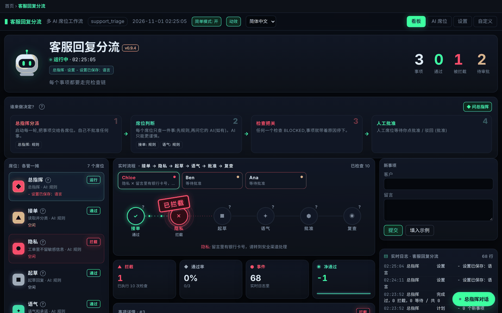
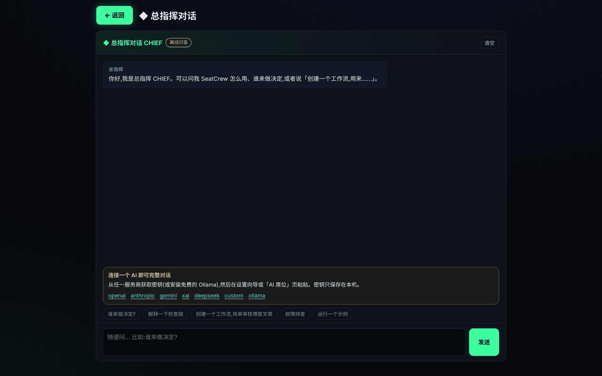
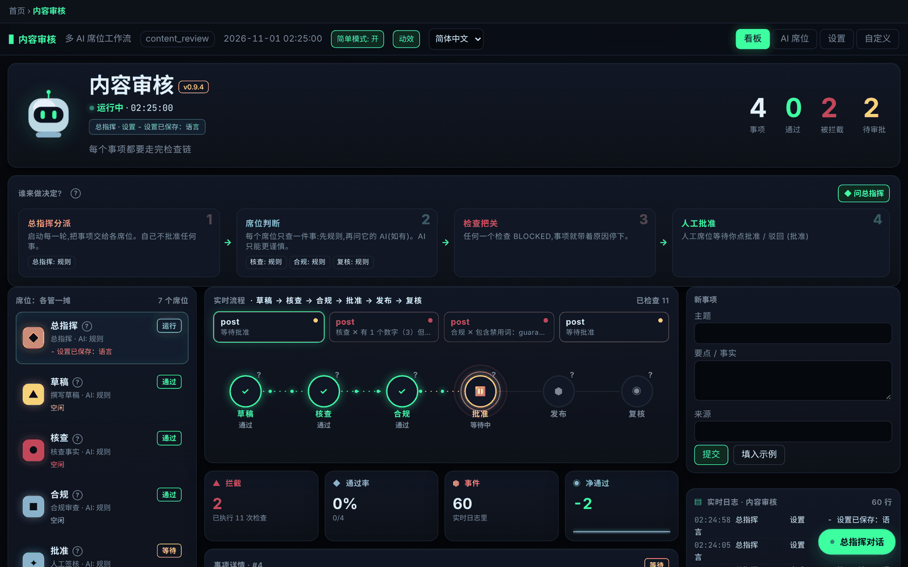
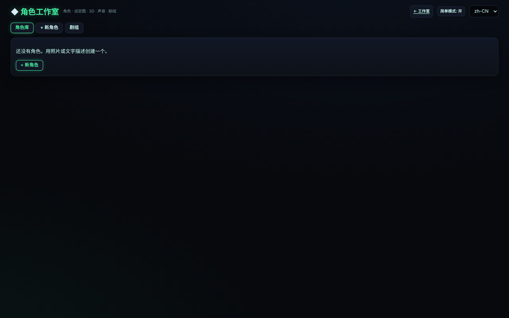
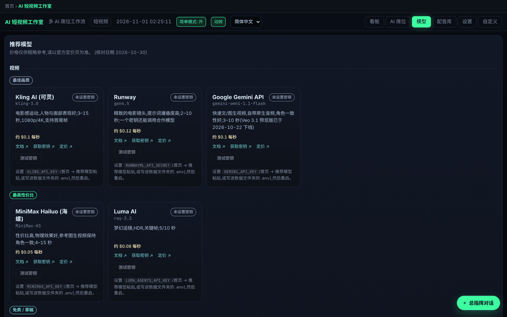

# SeatCrew 🪑🤖

[English](README.md) · [简体中文](README.zh-CN.md)

**SeatCrew：多 AI「席位」工作流框架。** 每项工作一个席位，每个事项都要走完检查链；任何大模型（或者纯规则）都可以坐进任何席位。

> **交易只是成品展示，不是重点。** 旗舰示例 [TradeCrew](examples/trading/README.zh-CN.md) 是基于这套引擎的完整多 AI 模拟交易终端。同一套引擎还能跑内容审核、只用 YAML 写成的客服回复分流，以及短视频工作室。



*截图来自 v0.9.4，未配置任何 API 密钥。动画遵循系统「减少动态效果」设置，也可以在设置里或点「动效」按钮关闭。*

## 更新内容

见 [CHANGELOG.md](CHANGELOG.md)。渲染视频需要系统 PATH 里有 **FFmpeg 和 ffprobe**；桌面版已自带免费的 Edge 配音组件。

> **如实说明**：付费服务商（视频、图像、3D、云端配音、付费大模型）目前只做了模拟 HTTP 测试，**还没有用真实密钥测过**。真实跑通的是无密钥路径（edge-tts + 草稿画面）和本地 Ollama。**克隆声音必须事先得到说话人的明确同意。**

## 3 分钟上手
1. 用下面任一方式安装并打开 SeatCrew，首次启动会出现设置向导。
2. SeatCrew 自动检测本机（系统、NVIDIA 显卡和显存、内存、磁盘、已安装的 `codex` / `claude` / `ollama`、已有密钥），给出推荐方案。点 **一键使用推荐设置** 即可，没有密钥也能马上用。
   - **用 ChatGPT / Codex 登录** 或 **用 Claude 登录**：通过官方命令行工具（`codex login`、`claude auth login`）使用你自己的订阅，席位和总指挥会调用 `codex exec` / `claude -p`。SeatCrew 只显示登录链接和验证码，绝不读取或保存你的令牌。
   - 也可以粘贴 7 家服务商之一的密钥，或用免费的本地 **Ollama**，或用演示模式。
3. 选择一个入门工作流（客服分流 / 内容审核 / 模拟交易），立即打开。

不需要自备模型：每个席位都能只用规则运行，AI 可以按席位单独开启。「简洁模式」默认开启，隐藏高级参数；每个席位和检查都有 **?** 提示；每个看板都有「谁来做决定?」卡片：总指挥分派 → 席位判断 → 检查把关 → 人工批准。


## 和总指挥对话
点右下角的 **◆ 总指挥对话**（首页和每个看板都有），或打开 `/chat` 全屏页面。可以问：「谁来做决定?」、「创建一个审核求职申请的工作流」（先预览 YAML，确认后才保存）、「切换到浅色主题」（先显示改动，确认后才应用）、「运行一个示例」、「为什么 AI 不工作?」。

总指挥使用你接入的任意服务商（包括 Ollama）。**不点「确认」什么都不会改变**；密钥绝不发给 AI，也不会存进聊天记录（粘贴的密钥会被自动清除）；聊天无法修改券商、实盘或服务商设置，交易永远只是模拟盘。记录保存在本地 `chat.json`，可以一键清空。没有接入 AI 时进入离线问答模式，并给出获取密钥的链接。



## 安装（三选一）

### 一、让你的 AI 编程助手来装（最简单）
打开 Codex、Claude Code、Cursor 或任何能在你电脑上执行命令的编程助手，粘贴：

```text
请从 https://github.com/same222111/seatcrew 帮我安装 SeatCrew。严格按照仓库里的 INSTALL_WITH_AI.md 操作：
macOS/Linux 运行 install.sh，Windows 运行 install.ps1，检查最后的 RESULT 行，在我的桌面放一个 SeatCrew 快捷方式，
打开一次确认窗口出现，然后告诉我你做了什么。不要向我要 API 密钥，没有密钥也能用。
```

### 二、下载安装包
到 [Releases](https://github.com/same222111/seatcrew/releases) 下载：Windows 用 `SeatCrew-<v>-windows-setup.exe`（或便携版 `.zip`），macOS 用 `SeatCrew-<v>-macos.dmg`（首次打开请右键 → 打开，应用未经公证），Linux 用 `SeatCrew-<v>-x86_64.AppImage`（先 `chmod +x`）。双击即可打开独立窗口。

**安装位置与数据文件夹**：Windows 安装包可以选择安装目录（例如 `D:\SeatCrew`），按用户安装，不需要管理员权限，升级时会记住上次的选择。便携版自带 `portable.txt`，数据保存在程序旁边的 `data` 文件夹。数据文件夹（设置、方案、历史、密钥）可以在首次向导里选择，之后在首页点「更改数据文件夹」修改。环境变量 `SEATCREW_DATA_DIR` 的优先级最高。首页会把用户目录显示为 `~`，截图不会泄露用户名。

### 三、终端一行命令
```bash
curl -fsSL https://raw.githubusercontent.com/same222111/seatcrew/main/install.sh | bash        # macOS / Linux
irm https://raw.githubusercontent.com/same222111/seatcrew/main/install.ps1 | iex                # Windows PowerShell
```

## 两个核心理念
1. **各管一摊**：一个工作流由若干席位组成。总指挥负责分派，其余席位按你的业务来定（例如起草、核查、合规、人工审批）。调度器按计划运行，也可以点「立即运行」。每个席位都可以单独指定 AI（OpenAI / Anthropic / Gemini / Grok / DeepSeek / 任意 OpenAI 兼容接口 / 本地 Ollama），也可以只用规则。
2. **想法不等于扳机**：每个事项都要按顺序走完检查链。每个席位给出「通过」或「拦截」以及原因，**任何一环出错都会被拦下**。人工席位会让事项停下，等人批准或驳回。最后由复查席位复盘，必要时撤销结果。

**AI 只能让决策更谨慎**：AI 可以增加拦截，不能取消拦截。AI 出错时弃权，由规则决定。没有任何密钥也能完整运行。

## 自带示例
- `trading`：旗舰成品 TradeCrew，多 AI 模拟交易终端。
- `content_review`：内容审核（Python，约 100 行），草稿 → 核查 → 合规 → 人工批准 → 发布 → 复核。
- `support_triage`：客服回复分流（只用 YAML），接单 → 隐私 → 起草 → 语气 → 人工批准 → 复查。
- `short_video`：短视频工作室，导演 · 编剧 → 审稿 → 制作 → 剪辑 + 质检 → 你来批准。

| 内容审核（人工把关） | 角色工作室 |
|---|---|
|  |  |

## 快速开始
```bash
git clone https://github.com/same222111/seatcrew.git && cd seatcrew
python -m venv .venv && . .venv/bin/activate
pip install -e .
seatcrew --lang zh-CN list
seatcrew ui content_review             # 看板地址 http://127.0.0.1:8800
seatcrew new my_flow                   # 名称只能用小写英文字母、数字和下划线
tradecrew start                        # 完整交易终端
```
`--lang zh-CN` 放在子命令前后都可以，例如 `seatcrew --lang zh-CN video init demo` 会生成中文分镜脚本。

## 免费配音与声音克隆（必须征得同意）
默认使用免费的 edge-tts。可以在向导里一键安装本地引擎 **CosyVoice**（Apache-2.0）或 **GPT-SoVITS**（MIT），装到你选的数据文件夹（例如 D 盘）。没有 NVIDIA 显卡时会用 CPU，速度较慢。F5-TTS、Fish Speech 的权重仅限非商业用途，默认不安装。**未经本人许可，禁止克隆任何人的声音**：只能克隆你自己或已明确同意者的录音，每个克隆声音都必须勾选同意并记录日期，不得用于冒充或欺骗。

## 自定义与分享
- 每个工作流页面左上角都有「← 返回首页」按钮和面包屑；按 Esc（不在输入框时）或 Alt+← 也能返回。
- 「自定义」标签页可以修改该工作流的全部参数：每个席位的 AI 和提示词、阈值、工作流参数，以及显示（深色 / 浅色 / 高对比度主题、字号、布局密度）和语言。可以「另存为方案」，方案里永远不会保存 API 密钥。
- 「导出 / 分享」可以下载 `.seatcrew.json` 文件，或复制 `SC1.…` 分享码。对方点「导入…」后先预览作者、版本和每一处改动，确认后才导入。导出和导入时都会自动去除密钥。
- 想按自己的需求改造：把整个仓库交给你自己的 AI（Codex / Claude / ChatGPT / Cursor），并贴上 [CUSTOMIZE.md](CUSTOMIZE.md) 里的提示词。

## 视频工作流
`short_video` 工作流可以从主题或脚本生成竖屏或横屏短视频。角色在所有视频中保持同一音色和参考图，付费生成前会先显示费用和时间估算。没有真实配音和真实画面的视频会标注为草稿预览，只用于检查节奏，不代表成片效果。完整说明见 [docs/VIDEO.zh-CN.md](docs/VIDEO.zh-CN.md)。



### 推荐模型（2026-10-30 核对，价格请以官网为准）
除 edge-tts 外，各适配器仅做了模拟 HTTP 测试。

| 档位 | 类型 | 服务商 | 模型 | 擅长 | 环境变量 | 文档 | 获取密钥 | 价格 |
|---|---|---|---|---|---|---|---|---|
| 最佳画质 | 视频 | Kling AI（可灵） | `kling-3.0` | 电影感运动、人物与面部，3-15 秒，1080p/4K，首尾帧 | `KLING_API_KEY` | [文档](https://kling.ai/document-api/guides/get-started/quick-start) | [获取密钥](https://kling.ai/dev/api-key) | [价格](https://kling.ai/dev/pricing) |
| 最佳画质 | 视频 | Runway | `gen4.5` | 精致电影镜头、提示词遵循强，2-10 秒 | `RUNWAYML_API_SECRET` | [文档](https://docs.dev.runwayml.com/guides/using-the-api/) | [获取密钥](https://dev.runwayml.com/) | [价格](https://docs.dev.runwayml.com/guides/pricing/) |
| 最佳画质 | 视频 | Google Gemini API | `gemini-omni-1.1-flash` | 快速文/图生视频，原生音频，角色一致（Veo 3.1 预览版已于 2026-10-22 关停） | `GEMINI_API_KEY` | [文档](https://ai.google.dev/gemini-api/docs/omni) | [获取密钥](https://aistudio.google.com/apikey) | [价格](https://ai.google.dev/gemini-api/docs/pricing) |
| 性价比 | 视频 | MiniMax Hailuo（海螺） | `MiniMax-H3` | 性价比高、物理效果好、参考图保持角色一致，4-15 秒 | `MINIMAX_API_KEY` | [文档](https://platform.minimax.io/docs/guides/video-generation) | [获取密钥](https://platform.minimax.io/console/keys) | [价格](https://platform.minimax.io/docs/pricing/overview) |
| 性价比 | 视频 | Luma AI | `ray-3.2` | 梦幻运镜、HDR、关键帧，5/10 秒 | `LUMA_AGENTS_API_KEY` | [文档](https://docs.agents.lumalabs.ai/guides/videos/generation/) | [获取密钥](https://platform.lumalabs.ai/) | [价格](https://docs.agents.lumalabs.ai/guides/pricing/) |
| 免费 / 草稿 | 视频 | 离线草稿画面 | `-` | 免费离线，标注 DRAFT，仅用于检查节奏 | 无需密钥 | - | - | - |
| 最佳画质 | 配音 / TTS | ElevenLabs | `eleven_multilingual_v2 (default) / eleven_v3 / eleven_v4 via SEATCREW_ELEVEN_MODEL` | 表现力最强，即时声音克隆，精确词级时间戳 | `ELEVENLABS_API_KEY` | [文档](https://elevenlabs.io/docs/overview/models) | [获取密钥](https://elevenlabs.io/app/developers/api-keys) | [价格](https://elevenlabs.io/pricing/api) |
| 最佳画质 | 配音 / TTS | MiniMax Speech | `speech-2.8-hd` | 中文非常自然，情绪参数，10 秒以上样本即可克隆 | `MINIMAX_API_KEY` | [文档](https://platform.minimax.io/docs/api-reference/speech-t2a-http) | [获取密钥](https://platform.minimax.io/console/keys) | [价格](https://platform.minimax.io/docs/pricing/overview) |
| 性价比 | 配音 / TTS | ByteDance Doubao / Volcano Engine（豆包语音） | `seed-tts-2.0` | 自然的中文音色与情绪，声音复刻（seed-icl-2.0） | `VOLC_TTS_API_KEY` | [文档](https://docs.volcengine.com/docs/doubao-voice/http-chunked-sse-unidirectional-streaming-v3?lang=zh) | [获取密钥](https://console.volcengine.com/speech/app) | [价格](https://docs.volcengine.com/docs/doubao-voice/billing-instructions?lang=zh) |
| 性价比 | 配音 / TTS | Azure AI Speech | `Neural / HD voices (zh-CN-XiaoxiaoNeural ...)` | 真实 SSML 说话风格（悲伤、温柔、开心……），支持 zh-CN/en/ja | `AZURE_SPEECH_KEY`, `AZURE_SPEECH_REGION` | [文档](https://learn.microsoft.com/en-us/azure/ai-services/speech-service/speech-synthesis-markup-voice) | [获取密钥](https://portal.azure.com/#create/Microsoft.CognitiveServicesSpeechServices) | [价格](https://azure.microsoft.com/en-us/pricing/details/speech/) |
| 性价比 | 配音 / TTS | OpenAI TTS | `gpt-4o-mini-tts` | 用提示词控制语气（已弃用，2027-01-06 关停） | `OPENAI_API_KEY` | [文档](https://developers.openai.com/api/docs/guides/text-to-speech) | [获取密钥](https://platform.openai.com/api-keys) | [价格](https://developers.openai.com/api/docs/pricing) |

### 角色工作室
在视频工作室中打开 `/characters`。可以用照片或文字描述创建角色，并用 OpenAI、Gemini、MiniMax 或 Replicate FLUX 生成一致的设定图（正面、侧面、全身、表情）。可选的图生 3D（Meshy、Tripo、Replicate）会在内置的 360° 查看器中展示。可以锁定角色参考图、绑定或克隆音色，并组建最多 5 人的剧组并分配角色。点击「用这个剧组拍摄」会生成对话场景：台词只分给剧组成员，镜头按全景 → 过肩 → 特写安排，硬切、无背景音乐、带房间底噪，可选对口型，并进行连贯性质检。没有密钥时生成带 DRAFT 标记的设定图和平面"立牌"模型。所有云端适配器仅做了模拟测试。说明与局限见 [docs/VIDEO.md](docs/VIDEO.md#character-studio-characters)。

## 安全
- 看板只监听 `127.0.0.1`，没有登录验证，请勿暴露到公网。
- 密钥只从环境变量或 `.env` 读取；接口只报告密钥「是否存在」，服务商的报错会去除密钥内容。
- 交易示例**只做模拟盘**，属于教学软件，不构成投资建议。

采用 MIT 许可证，参与贡献见 [CONTRIBUTING.md](CONTRIBUTING.md)。
