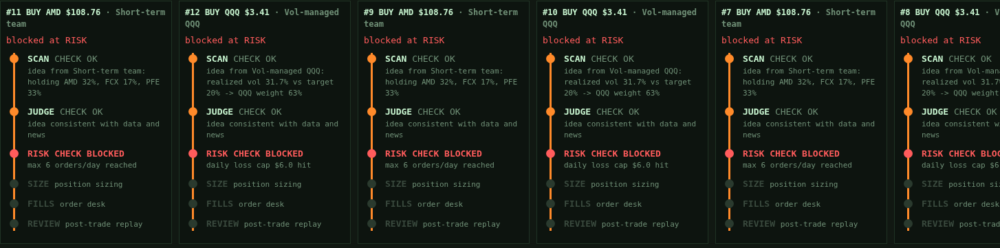
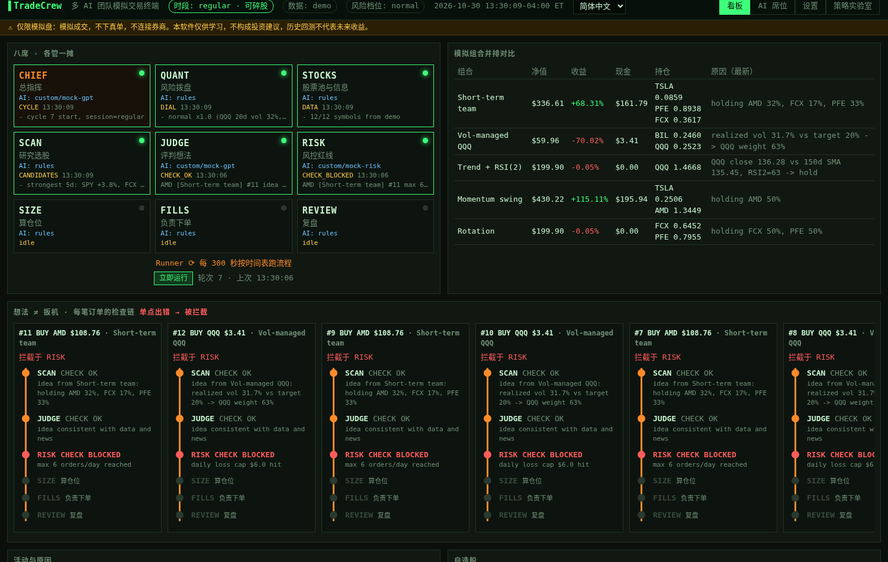
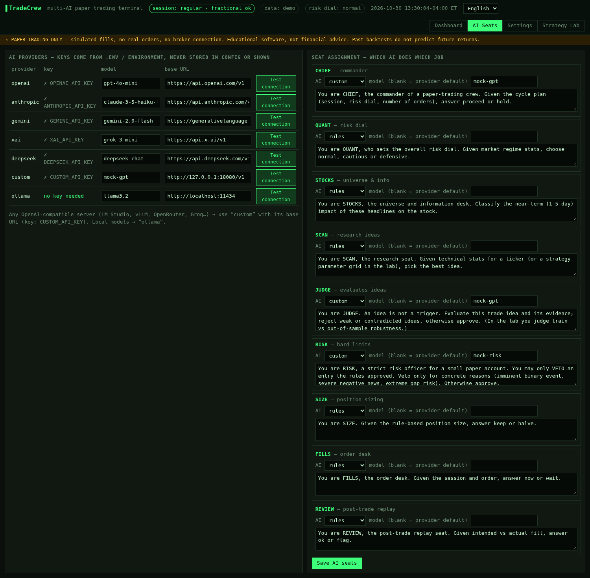
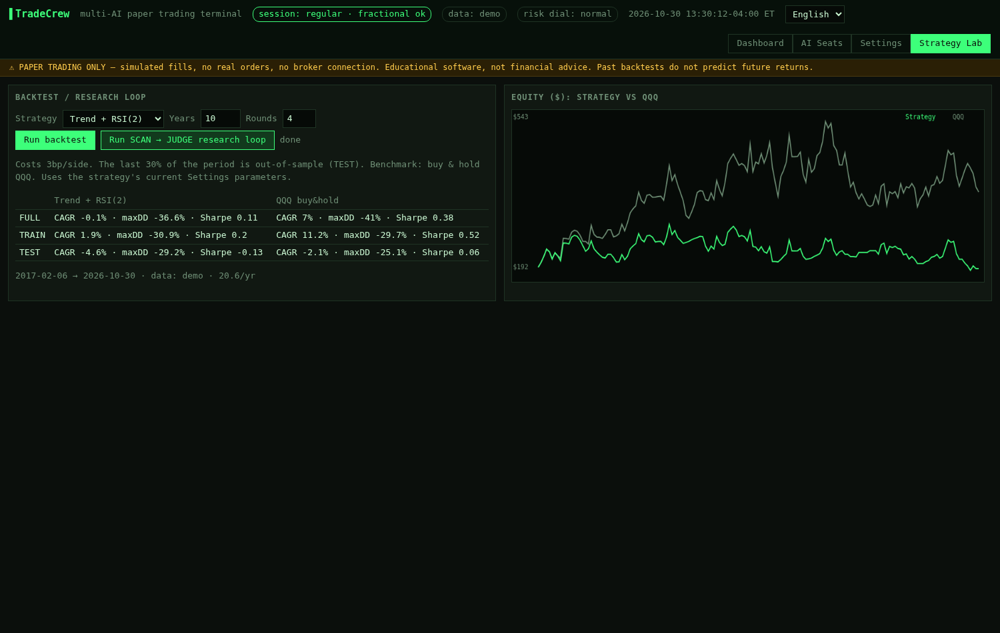

# TradeCrew 🧑‍✈️📈

> This is the **flagship example** of the [SeatCrew](../../README.md) framework: the complete trading app, built on the generic seat engine. Run it with `tradecrew start` (full terminal) or `seatcrew ui trading` (generic dashboard).

**A multi-AI-team paper-trading terminal, built as a template you can reshape with your own AI.** Eight seats each own one job (CHIEF, QUANT, STOCKS, SCAN, JUDGE, RISK, SIZE, FILLS, plus a REVIEW replay seat), and a Runner drives them on a schedule. **Idea ≠ trigger:** every order walks a check chain (research → judge → risk → size → order → review), and a single failed check stops it. Give each seat its own AI: OpenAI, Anthropic, Google Gemini, xAI Grok, DeepSeek, **any OpenAI-compatible endpoint** (OpenRouter, Groq, Together, LM Studio, vLLM…) or **local Ollama**. You can also run every role on plain rules with no key at all. You pick the watchlist, the strategies and the data and news sources from a web Settings page. Then you watch the crew trade side-by-side paper portfolios in a terminal-style dashboard, with a written reason for every decision.

> ⚠️ **Paper trading only.** TradeCrew never connects to a broker and never sends real orders. It is educational software, not financial advice. Backtests do not predict future returns.


> 🧩 **It's a template.** Hand the repo to Codex, Claude, ChatGPT or Cursor with a prompt from [CUSTOMIZE.md](../../CUSTOMIZE.md). [AGENTS.md](AGENTS.md) gives your AI the architecture map, the extension points and the rules it must keep.
>
> 🌐 **Languages:** English, 简体中文, 繁體中文, 日本語, Español. You can switch in the wizard, in Settings or in the header, or use `tradecrew --lang ja`.

## Features
- **Pluggable AI providers.** API keys live in `.env` and never go into the config or the UI. Every provider has a **Test connection** button in the UI and a `tradecrew test-ai` command that make a real minimal call and report the model, latency or a clear error.
- **Eight seats, each owns one job.** The seat grid shows who is active right now. Pick a provider, a model and an editable prompt for each seat, or choose `rules`. AI can only make a trade *more* conservative (block on bearish news, veto, halve the size, wait). It never forces one. Failures, timeouts, bad JSON and budget limits all make that AI abstain, and the rules carry on.
- **Your universe and strategies.** Edit the watchlist and turn each strategy on or off with its own parameters. Each strategy runs **its own paper portfolio** so you can compare them:
  - Short-term team (trend + daily strength, ATR stop, 1% risk sizing)
  - Vol-managed QQQ (volatility targeting)
  - Trend + RSI(2) (hold above the SMA, buy oversold bounces below it)
  - Momentum swing (20-day breakouts, take-profit, stop and trailing exits)
  - Rotation (hold the strongest of a small universe, 1 slot → 2 slots as equity grows)
- **Your information sources.** Price data comes from **yfinance** (free, the default), **Alpaca** or **Polygon** (with a key), or **demo** (offline synthetic data). Enabled sources act as automatic fallbacks. News comes from any list of **RSS feeds** with a `{symbol}` placeholder, and each feed can be turned on or off.
- **Strategy Lab.** Backtests include costs and a train / out-of-sample split against buy & hold QQQ, plus an equity chart. A **proposer → validator research loop** can be driven by AI or by rules.
- **24-hour session awareness.** The terminal knows the pre-market, regular, after-hours, overnight and closed sessions. Slippage depends on the session, fractional shares only trade in regular hours, and orders queue while the market is closed.
- **Check chain per order.** Each order card shows a vertical timeline of CHECK OK / CHECK BLOCKED steps with their reasons. REVIEW replays every fill and reverts it if slippage or cash look wrong. A QUANT risk dial (normal / cautious / defensive) scales every size.
- **Risk guard.** A kill switch, a daily loss cap and a maximum number of orders per day.
- **Smooth setup.** A first-run wizard, a Settings page that saves to `config.yaml` and applies on the next cycle, a CLI, Docker and a `.env.example`.

## Quick start
```bash
git clone https://github.com/same222111/seatcrew.git && cd seatcrew
python -m venv .venv && . .venv/bin/activate
pip install .                     # or: pip install -r requirements.txt
cp .env.example .env              # optional: add any AI keys you have
tradecrew start                   # open http://127.0.0.1:8787
```
The first-run wizard asks for your paper capital, watchlist, AI and data source. With no keys it runs in rules-only mode.

**Docker:** `docker build -t tradecrew . && docker run -p 127.0.0.1:8787:8787 --env-file .env -v $PWD:/data tradecrew`

## CLI
```bash
tradecrew test-ai                 # real call to every provider that has a key
tradecrew test-ai ollama --model llama3.2
tradecrew backtest trend_rsi2 --years 10
tradecrew research momentum_swing --rounds 6
tradecrew config --set seats.risk.provider '"anthropic"' --set watchlist '["SPY","QQQ","NVDA"]'
tradecrew init                    # terminal setup wizard
```

## Screenshots
| Check chain | Language | AI seats | Strategy Lab |
|---|---|---|---|
|  |  |  |  |

## How a cycle works
The `Runner` wakes every `scan_interval_sec`. `CHIEF` plans (and can hold new entries) → `STOCKS` loads the universe, prices and news → `QUANT` sets the risk dial → `SCAN` turns each strategy portfolio's target weights into ideas. Each idea then walks the chain:

`SCAN` (fresh price?) → `JUDGE` (falling knife, bearish news, AI reject) → `RISK` (session, kill switch, loss cap, order cap, AI veto) → `SIZE` (dial × dollars, whole shares off-hours, min $1, AI halve) → `FILLS` (paper fill + session slippage, AI wait) → `REVIEW` (replay: slippage, overfill, cash; reverts bad fills).

Every step is logged as `CHECK_OK` / `CHECK_BLOCKED` with its reason in `state/log.jsonl`. See [AGENTS.md](AGENTS.md) for the full seat table.

## Adding a language
1. Copy `examples/trading/tradecrew/locales/en.json` to `examples/trading/tradecrew/locales/<code>.json` and translate the values. Keep `{placeholders}`.
2. Add `"<code>": "Native name"` to `LANGUAGES` in `examples/trading/tradecrew/config.py`.
3. Run `pytest tests/test_i18n.py`. It checks that every locale has every key and placeholder.
Missing keys fall back to English.

## Honest results
See [docs/RESEARCH.md](../../docs/RESEARCH.md). In short, over 2023 to 2026 out-of-sample, none of the bundled strategies clearly beat buy & hold QQQ on return. Some of them cut drawdowns roughly in half.

## Security
- The server binds to `127.0.0.1` and has no authentication. Don't expose it to the internet.
- Keys are read from the environment or `.env` only. The API reports only *whether* a key is present, and provider errors are scrubbed of key material.
- `broker.LiveBroker` is a disabled stub. Live trading is out of scope.

## Contributing
See [CONTRIBUTING.md](../../CONTRIBUTING.md). MIT licensed.

---

## 中文说明

**TradeCrew：多 AI 团队模拟交易终端。** **八席，各管一摊**：CHIEF 总指挥、QUANT 风险档位、STOCKS 股票池与信息、SCAN 研究、JUDGE 判断、RISK 风控、SIZE 仓位、FILLS 下单，再加 REVIEW 复盘，由 Runner 按计划驱动。每个席位都可以分别指定 AI，支持 OpenAI、Anthropic、Gemini、Grok、DeepSeek、任意 OpenAI 兼容接口和本地 Ollama。没有 API Key 时，所有岗位都用纯规则运行。

- **想法 ≠ 扳机**：每笔订单都要依次经过 研究 → 判断 → 风控 → 仓位 → 下单 → 复盘，每一步都记录 CHECK OK 或 CHECK BLOCKED 和原因，单点出错就会被拦截。看板上每笔订单都有一条竖向时间线。
- **多语言**：English、简体中文、繁體中文、日本語、Español。在向导、设置页或页头都能切换，也可以用 `--lang`。新增语言：复制 `examples/trading/tradecrew/locales/en.json` 并翻译，然后在 `config.LANGUAGES` 里登记。
- **这是一个模板**：想按自己的喜好修改，就把整个仓库交给你自己的 AI（Codex / Claude / ChatGPT / Cursor），并贴上 [CUSTOMIZE.md](../../CUSTOMIZE.md) 里现成的提示词。[AGENTS.md](AGENTS.md) 告诉 AI 架构、扩展点和不能违反的规则。
- **只做模拟盘**：不连接券商，不下真单。本软件不构成投资建议。
- **设置全部在网页里完成**：选 AI、改提示词、改自选股、开关策略和参数、选数据源和新闻 RSS 源，保存后写入 `config.yaml`，下一轮扫描就生效。
- **测试连接**：每个 AI 都有"Test connection"按钮，也可以用命令 `tradecrew test-ai`，会真的调用一次接口，报告成功或具体错误。
- **多组合对比**：每个策略各自跑一个模拟组合，看板上并排显示，每笔交易都写明原因。
- **策略实验室**：回测时扣除交易成本，留出样本外数据检验，并和直接持有 QQQ 对比；还有"提出 → 验证"研究循环。
- **24 小时时段识别**：区分盘前、盘中、盘后、夜盘和休市，不同时段用不同的滑点和下单限制。

快速开始：`pip install .`，然后复制 `.env.example` 为 `.env` 并按需填写 Key，最后运行 `tradecrew start`，打开 http://127.0.0.1:8787 。
