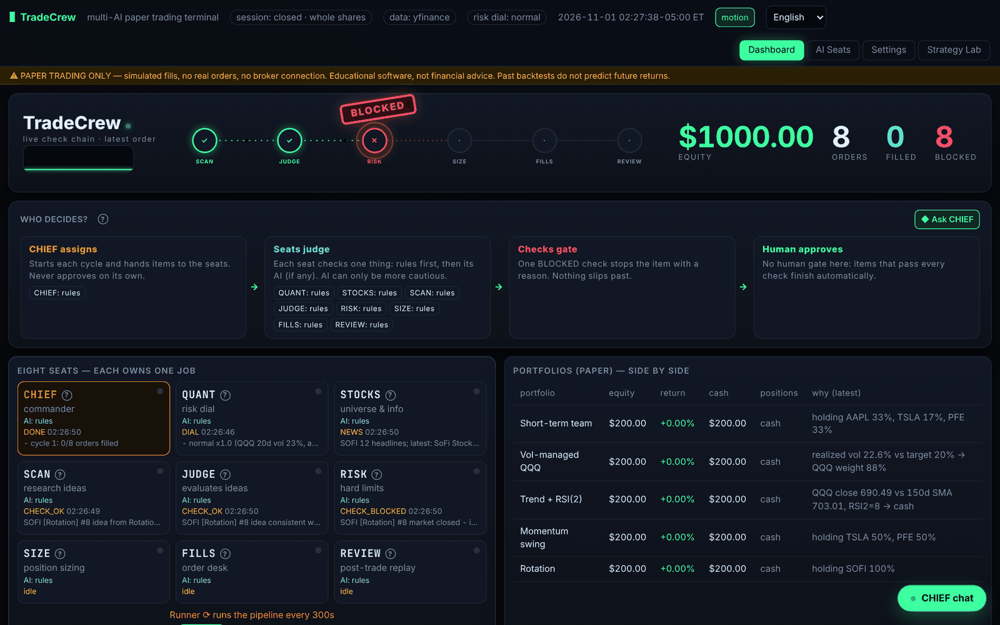

# TradeCrew 🧑‍✈️📈

[English](README.md) · [简体中文](README.zh-CN.md)

> 这是 [SeatCrew](../../README.zh-CN.md) 框架的**旗舰示例**：基于通用席位引擎的完整交易应用。用 `tradecrew start` 打开完整终端，或用 `seatcrew ui trading` 打开通用看板。

**TradeCrew：多 AI 团队模拟交易终端。** **各管一摊**：总指挥、风险档位、股票池与资讯、研究、判断、风控、仓位、下单，再加复盘席位，由调度器按计划驱动。每个席位都可以分别指定 AI，支持 OpenAI、Anthropic、Gemini、Grok、DeepSeek、任意 OpenAI 兼容接口和本地 Ollama。没有 API 密钥时，所有席位都用纯规则运行。

> ⚠️ **只做模拟盘**：不连接券商，不下真单。本软件属于教学用途，不构成投资建议，回测结果不代表未来收益。

- **想法不等于扳机**：每笔订单都要依次经过研究 → 判断 → 风控 → 仓位 → 下单 → 复盘，每一步都记录「通过」或「拦截」以及原因，任何一环出错都会被拦下。看板上每笔订单都有一条竖向时间线。
- **多语言**：界面支持英文、简体中文、繁体中文、日文和西班牙文。在向导、设置页或页头都能切换，也可以用 `--lang`。新增语言：复制 `examples/trading/tradecrew/locales/en.json` 并翻译，然后在 `config.LANGUAGES` 里登记。
- **这是一个模板**：想按自己的喜好修改，就把整个仓库交给你自己的 AI（Codex / Claude / ChatGPT / Cursor），并贴上 [CUSTOMIZE.md](../../CUSTOMIZE.md) 里现成的提示词。[AGENTS.md](AGENTS.md) 告诉 AI 架构、扩展点和不能违反的规则。
- **设置全部在网页里完成**：选 AI、改提示词、改自选股、开关策略和参数、选数据源和新闻订阅源，保存后写入 `config.yaml`，下一轮扫描就生效。
- **测试连接**：每个 AI 都有「测试连接」按钮，也可以用命令 `tradecrew test-ai`，会真的调用一次接口，报告成功或具体错误。
- **多组合对比**：每个策略各自跑一个模拟组合，看板上并排显示，每笔交易都写明原因。
- **策略实验室**：回测时扣除交易成本，留出样本外数据检验，并和直接持有 QQQ 对比；还有「提出 → 验证」研究循环。
- **24 小时时段识别**：区分盘前、盘中、盘后、夜盘和休市，不同时段用不同的滑点和下单限制。

快速开始：`pip install .`，然后复制 `.env.example` 为 `.env` 并按需填写密钥，最后运行 `tradecrew start`，打开 http://127.0.0.1:8787 。

**如实说明**：2023 到 2026 年的样本外测试中，自带策略的收益都没有明显跑赢直接持有 QQQ，其中一些策略把最大回撤降低了大约一半。详见 [docs/RESEARCH.md](../../docs/RESEARCH.md)。
